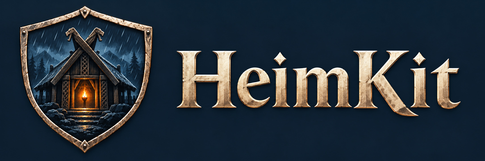
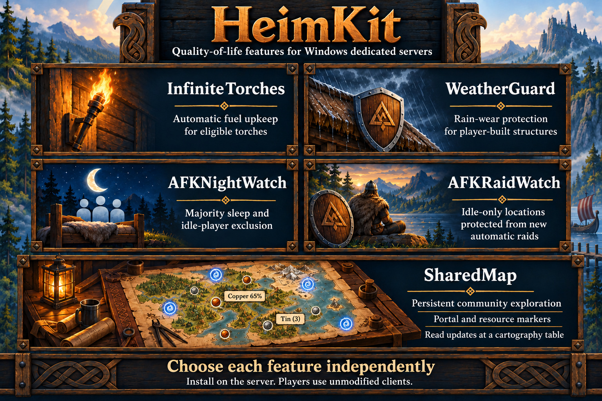
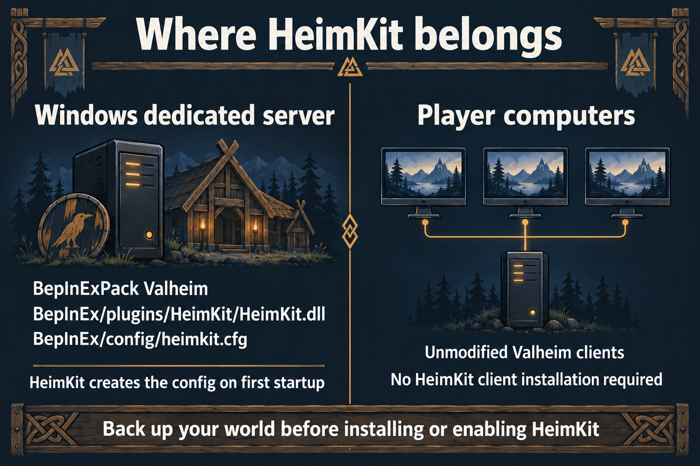

# HeimKit

HeimKit brings quality-of-life features to Windows Valheim dedicated servers: shared exploration, portal and resource markers, automatic torch upkeep, protection from weather wear, coordinated night skipping and raid protection for idle players.

Install HeimKit on the server and choose each feature independently through the server configuration. Players use unmodified Valheim clients with no additional downloads. Gameplay features pause when no players have joined the world and resume after players spawn.

## World safety

**HeimKit can corrupt a world or cause loss of progress. Back up your world before installing or enabling the mod.** See the [world backup guide](docs/world-backups.md) for Windows File Explorer and Valheim's in-game save-management options.

## Features

### InfiniteTorches

Keeps eligible torches and hanging/standing braziers supplied with fuel automatically, reducing manual refilling without spending player inventory materials. Normal water, smoke and obstruction behavior still applies, so fuel alone does not guarantee a lit torch.

[Usage and supported light sources](docs/features/infinite-torches.md) · [Technical specification](docs/specs/infinite-torches.md)

### WeatherGuard

Designed to prevent rain and wetness wear on eligible existing and newly player-built structures while preserving their original creators. Protection activates automatically during play without requiring a repair, logout or rejoin. Combat damage, repair, removal and structural support retain their normal gameplay roles. World-generated structures are outside its current scope.

[Usage and protection scope](docs/features/weather-guard.md) · [Technical specification](docs/specs/weather-guard.md)

### AFKNightWatch

Coordinates configurable majority sleep and idle-player sleep exclusion, so players can coordinate time skipping without waiting for inferred-idle players. A short grace period gives other players time to reach bed once the threshold is met; everyone in bed can start sleep immediately. Normal bed requirements and the native afternoon/night allowance remain. Server-observed activity informs idle detection, which cannot observe every local menu action.

[Usage and scope](docs/features/afk-night-watch.md) · [Technical specification](docs/specs/afk-night-watch.md)

### AFKRaidWatch

Protects idle-only locations from new normal automatic random raids, independently of sleep. Active or uncertain nearby players retain normal eligibility; active players elsewhere do not remove local protection. Existing raids and explicit, forced or standalone events remain unchanged. Idle protection uses the same server activity inference as sleep exclusion.

[Usage and scope](docs/features/afk-raid-watch.md) · [Technical specification](docs/specs/afk-raid-watch.md)

### SharedMap

Share exploration with the whole server through vanilla cartography tables. SharedMap collects terrain around players as they travel, preserves the community map across restarts and prepares table data without requiring someone to write first. Players choose **Read Map** at a table to receive the latest shared exploration and markers; updates do not appear automatically on an open player map. Shared death markers are excluded.

Its optional **PortalMarkerSync** subfeature maintains player-built portal markers in community-explored terrain, using current portal names, `NoName` for blank tags and grouped markers for nearby portals. SharedMap and PortalMarkerSync default enabled; portal sync can be disabled while exploration sharing continues. Existing personal or shared pins can interfere with vanilla marker replacement, so some players may need to remove an old duplicate locally and read the table again. Optional **ResourceMarkerSync**, enabled by default, records outdoor metal and Obsidian deposits as players travel and shares labeled dots through Read Map. Nearby Tin nodes are grouped with remaining discovered-node counts. Retrospective discovery in old explored terrain is separately optional and defaults off; scraps, dungeon resources and creature sources are excluded. Server owners can remove a selected unwanted shared pin while preserving other pins and exploration. Other automatic location markers are outside scope.

[Usage, configuration and marker limitations](docs/features/shared-map.md) · [Technical specification](docs/specs/shared-map.md)

## Compatibility

- Windows Valheim dedicated servers; Linux is not supported.
- Requires BepInExPack Valheim and a compatible game version. See the [supported environment](docs/server-setup.md#supported-environment) for version requirements. Versions outside the configured requirement disable the affected features. Operators can authorize one exact version through the [manual compatibility override](docs/server-setup.md#hidden-version-override) after reviewing compatibility.
- Designed for unmodified clients; HeimKit is installed on the dedicated server.

See [server setup](docs/server-setup.md) for installation and configuration.

## Setup

Follow the [setup guide](docs/server-setup.md#installation) to install with Thunderstore Mod Manager or manually, including manual installation when the manager is already installed.

## Documentation

- [Server setup](docs/server-setup.md) — supported environment, installation, configuration and general troubleshooting.
- [World backups](docs/world-backups.md) — copying world saves and using Valheim's save-management menu.
- [SharedMap](docs/features/shared-map.md) — community exploration, PortalMarkerSync, cartography table reads and separate map backups.
- [Development](docs/development.md) — build commands, Thunderstore packaging and plugin references.
- [Contributing](docs/contributing.md) — change procedure and documentation placement rules.
- [Architecture](docs/architecture.md) — code organization and shared design rules.
- [Contributor instructions](AGENTS.md) — required reading and project scope.

## License

HeimKit uses the [MIT License](LICENSE). Game files and dependencies retain their own licenses and are not distributed or relicensed by this project.

## Disclaimer

Use HeimKit at your own risk. This mod can corrupt your world or cause loss of progress and data. We are not responsible for world corruption, data loss or other damage resulting from its use. Back up your world before installing or using the mod; see the [world backup guide](docs/world-backups.md).
