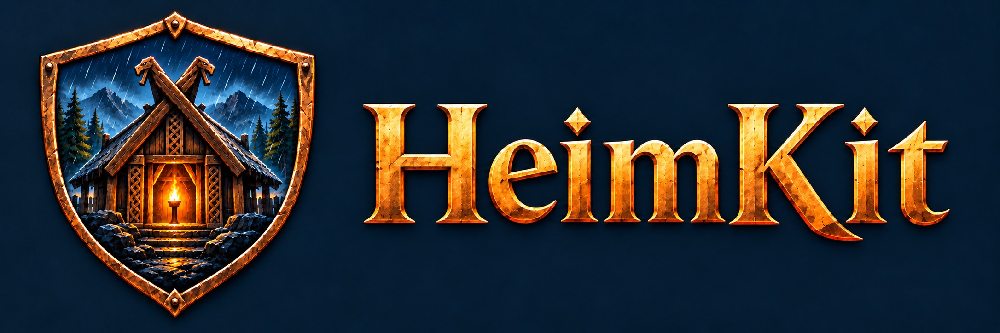
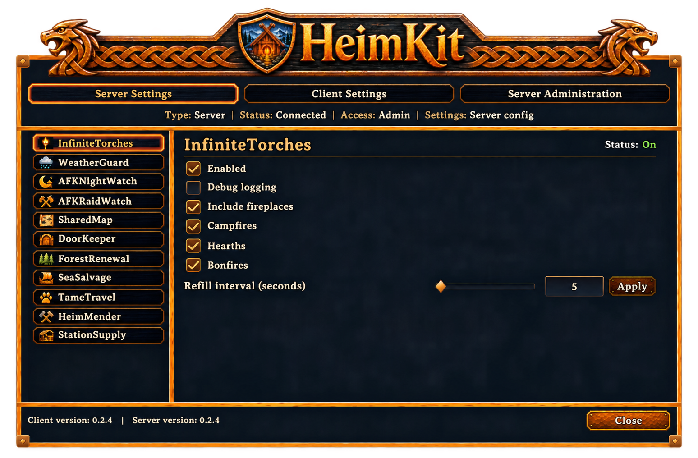
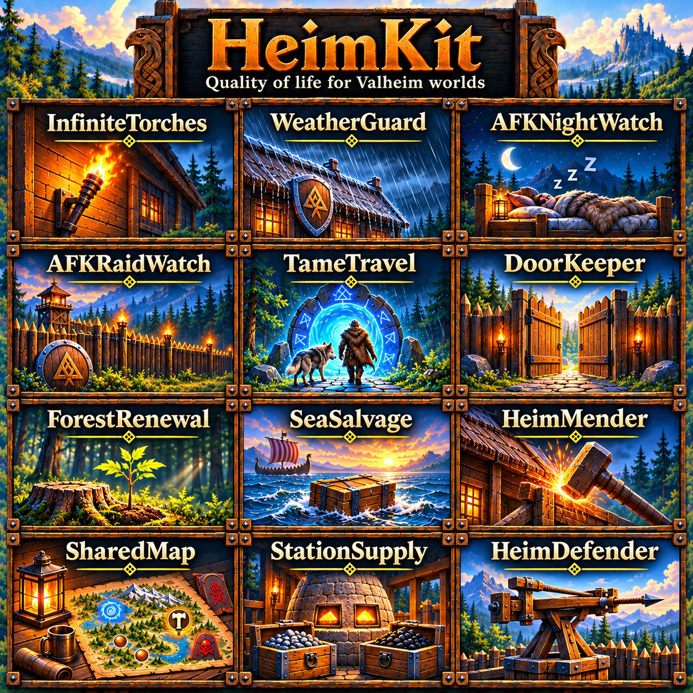
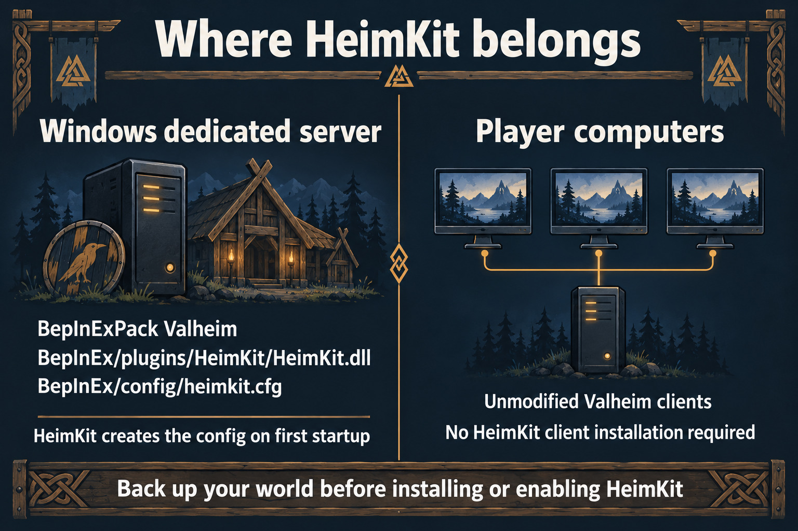

# HeimKit

Quality-of-life features for Windows Valheim worlds hosted in the game or on a dedicated server: infinite torches, shared map exploration and markers, weather protection, majority sleep, AFK raid protection, tame portal travel, door closing, tree renewal, sunken-loot recovery, gradual building repairs and production-station feeding.

Install HeimKit in the Windows game to run its features in your own world. Play solo or choose **Start Server** to invite friends. Guests can join without HeimKit.

The [HeimKit Settings guide](docs/heimkit-settings.md) shows how to use **F7**. Open **Server Settings** to manage the world you host, from door closing delays to shared map markers. Open **Client Settings** for interaction logging and your menu shortcut. World hosts and dedicated-server admins can use **Server Administration** to see who has joined and manage Valheim’s ban list, including while a player is offline. See [Moderate players](docs/heimkit-settings.md#moderate-players) for access and controls.

*Server Settings in the F7 menu, as seen by a dedicated-server admin.*

DoorKeeper, ForestRenewal, SeaSalvage, TameTravel, HeimMender and StationSupply default enabled. Review their guides to choose which features to keep on. Existing configuration values are preserved; missing settings are added automatically. Install only one HeimKit plugin DLL.

Before enabling HeimKit, follow [world backups](docs/world-backups.md) and read [safety and limitations](docs/limitations.md).

## Support HeimKit

If HeimKit makes your Valheim server more enjoyable, you can [support its development and maintenance on Buy Me a Coffee](https://buymeacoffee.com/heimkit). Contributions are completely optional. Thank you for using HeimKit!

## Features

### InfiniteTorches

Automatically refills eligible torches and hanging/standing braziers without spending inventory fuel. Optional campfire, hearth and bonfire refilling defaults off, with separate controls for each fire type.

[Usage and settings](docs/features/infinite-torches.md) · [Specification](docs/specs/infinite-torches.md)

### WeatherGuard

Protects existing and newly player-built structures from rain and underwater wear, preserving their creators. Activation is automatic during play. Combat, repair and structural support stay native; world-created claiming is excluded.

[Usage and settings](docs/features/weather-guard.md) · [Specification](docs/specs/weather-guard.md)

### AFKNightWatch

Combines configurable majority sleep with idle-player exclusion. A grace period gives others time to reach bed; everyone in bed can start immediately.

[Usage and settings](docs/features/afk-night-watch.md) · [Specification](docs/specs/afk-night-watch.md)

### AFKRaidWatch

Excludes idle-only locations from new automatic random raids. Nearby active or uncertain players retain normal eligibility. Sleep and raid controls are independent.

[Usage and settings](docs/features/afk-raid-watch.md) · [Specification](docs/specs/afk-raid-watch.md)

### SharedMap

Saves community exploration and discoveries across restarts, independently of cartography tables. Players choose **Read Map** at a vanilla table to receive updates. Shared death pins are filtered.

SharedMap’s marker options default enabled.

- **Portal Marker:** named player-built portals, with optional nearby grouping.
- **Resource Marker:** outdoor metal/Obsidian deposits and Black Marble skull/rib remains with `(ST)` for available Soft Tissue, Tin node counts and Copper/Silver/Black Marble mining progress, and discovered Ancient Roots with observed sap-reserve percentages. Silver requires pickaxe discovery.
- **Dungeon Marker:** labeled exterior entrance markers with the vanilla hammer icon and cleanup of nearby duplicate dungeon pins. Supported pickup percentages appear after observed entry or evidence of already-picked items.
- **Runestone Marker:** placed lore-runestone landmarks as labeled dots.
- **Structure markers:** house pins for discovered Fuling villages, Dvergr sites, and selected villages, ruins, cabins and fortresses in other biomes.
- **Spawner Marker:** visible, player-destructible recurring spawner objects as labeled dots, removed after confirmed source destruction.

Optional settings discover resources/dungeons in previously explored terrain or reject player map uploads while automatic collection continues. Enabled runestone, spawner and structure markers include eligible points in community-explored terrain. Optional shared X checkmarks default off. Server owners can remove a selected shared pin through server-side administration without clearing other pins or exploration.

[Usage, settings and administration](docs/features/shared-map.md) · [Specification](docs/specs/shared-map.md)

### DoorKeeper

Closes eligible player-built doors and gates after a delay once players clear the doorway. Native manual access remains; keyed and special doors are excluded. Defaults enabled.

[Usage and settings](docs/features/door-keeper.md) · [Specification](docs/specs/door-keeper.md)

### TameTravel

Brings explicitly following or portal-waiting tamed wolves, boars, lox, asksvin, hens and moose along a validated trip between linked player-built portals outside dungeons. Following tames can also enter and leave dungeons when they fit through the doorway and have room to land. Preserves the same animal and its saved state. One follow command covers successive portal trips and following continues at the destination until stopped. Follow, stay and optional portal-wait commands have vanilla emote fallbacks. Explicit followers can use configurable stopping distance through bounded server control. Following Dead Raiser skeletons can accompany their summoner through portals and native dungeon entrances and exits, including vanilla guests on a HeimKit host. Defaults enabled.

[Usage and settings](docs/features/tame-travel.md) · [Specification](docs/specs/tame-travel.md)

### ForestRenewal

Renews supported trees from stumps left behind or their confirmed-cleared locations, using vanilla saplings, renewal chance, delay, terrain/building exclusions and persisted cooldowns. Native growth requirements remain. Defaults enabled.

[Usage and settings](docs/features/forest-renewal.md) · [Specification](docs/specs/forest-renewal.md)

### SeaSalvage

Recovers eligible stable sunken item drops into ordinary floating cargo crates while preserving native item data. Active client-owned and unsupported drops wait or remain untouched. Defaults enabled.

[Usage and settings](docs/features/sea-salvage.md) · [Specification](docs/specs/sea-salvage.md)

### HeimMender

Gradually repairs damaged player-built structures with configurable cycles, chance and limits. Administrators can request nearby repairs, and its settings reload during play. Defaults enabled.

[Usage and administration](docs/features/heim-mender.md) · [Specification](docs/specs/heim-mender.md)

### StationSupply

Keeps production stations supplied with real materials from one nearby public chest per resource intake. Place separate chests beside the fuel and material hatches; an empty selected chest waits instead of drawing from other storage. Supports smelters, charcoal kilns, blast furnaces, windmills, spinning wheels, eitr refineries, Frigid Kilns and shield generators. Optional fermenter and Obliterator feeding default off. Obliterator input supports item categories and manual lever activation; output stays native.

[Usage and settings](docs/features/station-supply.md) · [Illustrated chest placement](docs/features/station-supply.md#placement-examples) · [Specification](docs/specs/station-supply.md)

## Setup and compatibility

HeimKit supports the Windows game and Windows dedicated servers with BepInExPack Valheim. For dedicated play, install HeimKit on the server. Guests can join with vanilla Valheim. Players who also install HeimKit can view settings in F7 if the server enables client support. Players on Valheim’s admin list can edit them if the server allows changes. See [supported environment](docs/server-setup.md#supported-environment) for exact requirements and [safety and limitations](docs/limitations.md) for gameplay/client constraints.

On dedicated servers, the default [server upgrade policy](docs/server-setup.md#server-upgrades) lets HeimKit attempt to keep working after Valheim updates, with a recorded world backup for newer server versions that is reused across restarts. [Persistent feature protection](docs/server-setup.md#persistent-feature-disables) disables failing features for the same world and HeimKit/Valheim version combination while healthy features continue. Installing a new HeimKit version retries features enabled in configuration. Server owners can instead restrict operation to the audited baseline. Existing settings receive [automatic configuration migration](docs/server-setup.md#configuration-migration).

Follow [server setup](docs/server-setup.md#installation) for Thunderstore Mod Manager or manual installation. Gameplay processing pauses when the server is empty and resumes after a player joins. Background conveniences pause during raids and detected battles including WeatherGuard protection and SharedMap background processing; see [feature lifecycle](docs/server-setup.md#feature-lifecycle).

## Documentation

- [Server setup](docs/server-setup.md): installation, configuration and diagnostics.
- [Windows client setup](docs/client-setup.md) for installation, local hosting and config locations.
- [HeimKit Settings](docs/heimkit-settings.md) for F7 controls by feature, host and admin access, and local preferences.
- [Safety and limitations](docs/limitations.md): world risks, server observations and client limitations.
- [World backups](docs/world-backups.md): automatic upgrade checkpoints and matching world, SharedMap and ForestRenewal recovery.
- [Server upgrade specification](docs/specs/server-upgrade-compatibility.md): compatibility policy, startup backups and persistent failure protection.
- [Changelog](CHANGELOG.md): release changes and history.
- Feature guides and specifications: linked under each feature in [Features](#features).
- [Development](docs/development.md): build and packaging commands.
- [Architecture](docs/architecture.md): shared design and lifecycle contracts.
- [Contributing](docs/contributing.md): source/documentation procedures.
- [Contributor instructions](AGENTS.md): task scope and authorization.

## License

[MIT](LICENSE). Game and dependency assets retain their own licenses.
