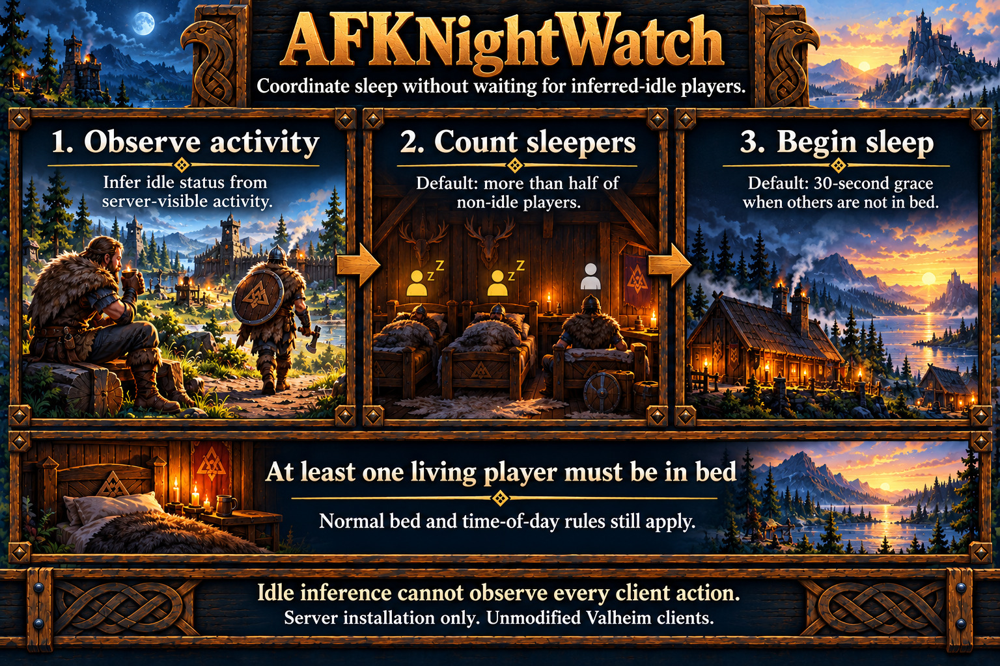

# AFKNightWatch

Coordinates majority sleep and excludes inferred-idle players from sleep voting. AFKRaidWatch controls raids independently. See [server setup](../server-setup.md#afknightwatch), [AFK limitations](../limitations.md#afk-detection-sleep-and-raids), and the [specification](../specs/afk-night-watch.md).

## Sleep rules

Defaults require strictly more than half of non-idle participants: one of two is insufficient; two of three is enough. A living player must be in bed. Once quorum is met while others remain outside bed, the default 30-second grace gives them time to join. Everyone in bed bypasses the wait. Lost quorum or reliable tracking restarts it. Native bed requirements, afternoon/night allowance and cooldown remain.

Majority and AFK exclusion are independent. Disabling majority requires unanimity among non-excluded participants. Disabling exclusion retains idle players in the vote. Majority sleep alone does not start AFK tracking.

## Configuration

Settings belong under `[AFKNightWatch]`; stop the server before edits and restart afterward.

| Setting | Default | Purpose |
| --- | --- | --- |
| Enabled | true | Enable sleep rules. |
| MajoritySleepEnabled | true | Use the configured quorum. |
| ExcludeAFKFromSleep | true | Remove eligible idle non-sleepers from the vote. |
| RequiredSleepingPercent | 50 | Percentage threshold; 1–100. |
| RequireMoreThanPercent | true | Strictly exceed the threshold; 100 requires everyone. |
| SleepDelaySeconds | 30 | Continuous quorum grace; 0–300 real seconds. |
| DebugMode | false | Feature diagnostics through the [shared debug policy](../server-setup.md#configuration). |

Shared idle thresholds and activity signals are defined under [PlayerActivity](../server-setup.md#playeractivity). Health changes do not count as activity.

## Diagnostics

Info reports confirmed sleep starts assisted by these rules while some players were outside bed. Debug explains participants, sleepers, exclusions, required count, grace and native timing. Shared PlayerActivity owns named AFK entry/exit notices, visible with debugging off. Sleep and raid diagnostics remain independent.

Sleep and shared activity sampling reuse working buffers; voting rules and activity timing remain unchanged.
