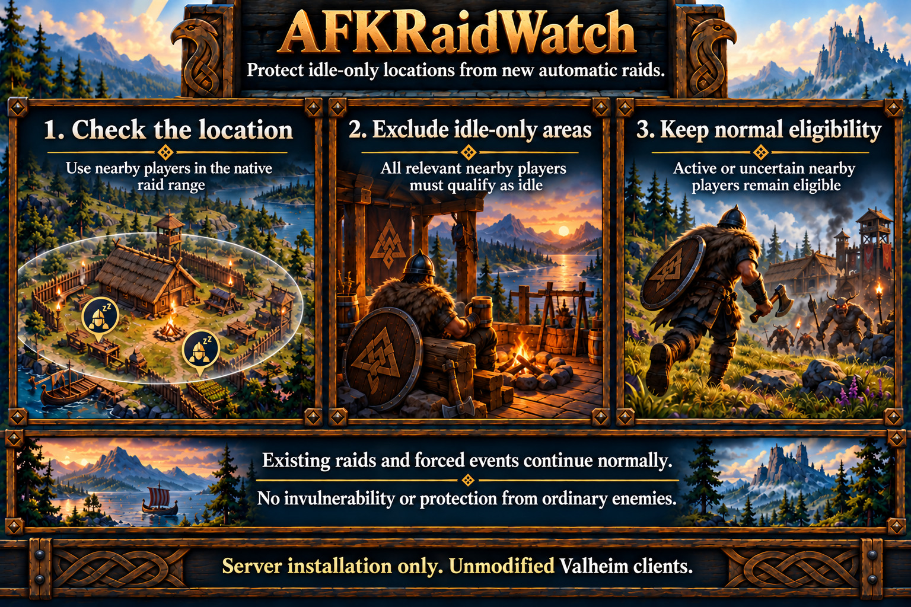

# AFKRaidWatch

Protects inferred-idle-only locations from new automatic random raids. AFKNightWatch controls sleep independently. See [server setup](../server-setup.md#afkraidwatch), [AFK limitations](../limitations.md#afk-detection-sleep-and-raids), and the [specification](../specs/afk-raid-watch.md).

## Protection rules

Within native event range, every relevant nearby player must be known, alive, outside beds and inferred idle. Active, dead, loading or uncertain nearby players retain normal eligibility. Active players elsewhere do not remove protection from an idle-only area.

Only ordinary automatic random-event selection is filtered. Existing raids, explicit/admin events and forced/scripted events retain native behavior. Detection continues during daylight while an enabled consumer needs it.

## Configuration

`[AFKRaidWatch] Enabled = true` controls protection; `DebugMode = false` controls feature diagnostics through the [shared debug policy](../server-setup.md#configuration). Stop the server before edits and restart afterward.

Shared thresholds live under [PlayerActivity](../server-setup.md#playeractivity), with defaults of five minutes idle and one minute join/recovery grace. Health changes do not count as activity. This feature works with sleep rules disabled.

## Diagnostics

Info groups excluded candidates once per native automatic selection pass. Debug explains local population, eligibility reasons, native gates and observed event transitions. Shared PlayerActivity owns named AFK entry/exit notices, visible with debugging off. Raid debugging does not enable sleep diagnostics.
