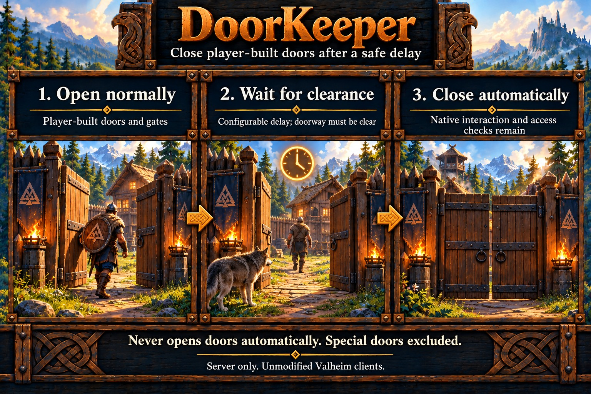

# DoorKeeper

Closes supported player-built doors and gates once they have been open for the configured delay (five seconds by default) and the doorway is clear. It never automatically opens doors. Keyed, world/dungeon, one-way, inverted and unsupported controls are excluded.

Supported types are wood door, wood gate, wood fence gate, darkwood gate, iron gate, stave gate, Dvergr wood door, hexagonal gate, flametal gate and ashwood door. Native prefab/component checks select the exact supported definitions in the [specification](../specs/door-keeper.md).

One due, clear door is prepared per pass; unready terrain or surrounding objects postpone closing. Server ownership lasts only for the close attempt. Manual operation keeps native interaction and ward/access checks. A restart begins a fresh delay for doors left open.

## Configuration

Use `[DoorKeeper]` in `heimkit.cfg`. This feature defaults enabled; set Enabled=false to disable it. Stop the server before editing and restart to apply settings. HeimKit preserves existing values and supplies missing defaults.

| Setting | Default | Purpose |
| --- | --- | --- |
| Enabled | true | Enable DoorKeeper. |
| DebugMode | false | Enable feature diagnostics through the shared debug policy. |
| CloseDelaySeconds | 5 | Continuous observed open time before closing. |
| ClearanceMeters | 3 | Minimum occupancy sphere radius; native gate geometry can enlarge it. |
| ScanRangeMeters | 64 | Range around a rotating ready player. |
| IntervalSeconds | 2 | Processing interval. |

Ranges and selection rules are in the [specification](../specs/door-keeper.md). DebugMode follows the [shared debug/suppression policy](../server-setup.md#diagnostics).

## Diagnostics

Normal output groups confirmed results per completed pass and preserves failures and lifecycle notices. Optional Debug summaries describe changed current scope and result counts at most once per minute. `scope` counts tracked open doors; `results` counts completed operations in the latest pass; `lifetime_results` counts them during the current controller lifetime. Counts restart when the controller is recreated. Empty unchanged scopes are quiet. Eligibility summaries include context_ready, delay_wait and occupied. Wide/tall doors use a larger native geometry-based occupancy sphere.

See [shared safety and delivery limitations](../limitations.md#new-world-features).

## HeimKit log topics

- `doors`: Door eligibility, clearance and closing.

Shared lifecycle, configuration, scope and timing topics follow the [logging contract](../architecture.md#logging). Verbose evidence requires effective debugging and the shared DebugVerbosity setting.
