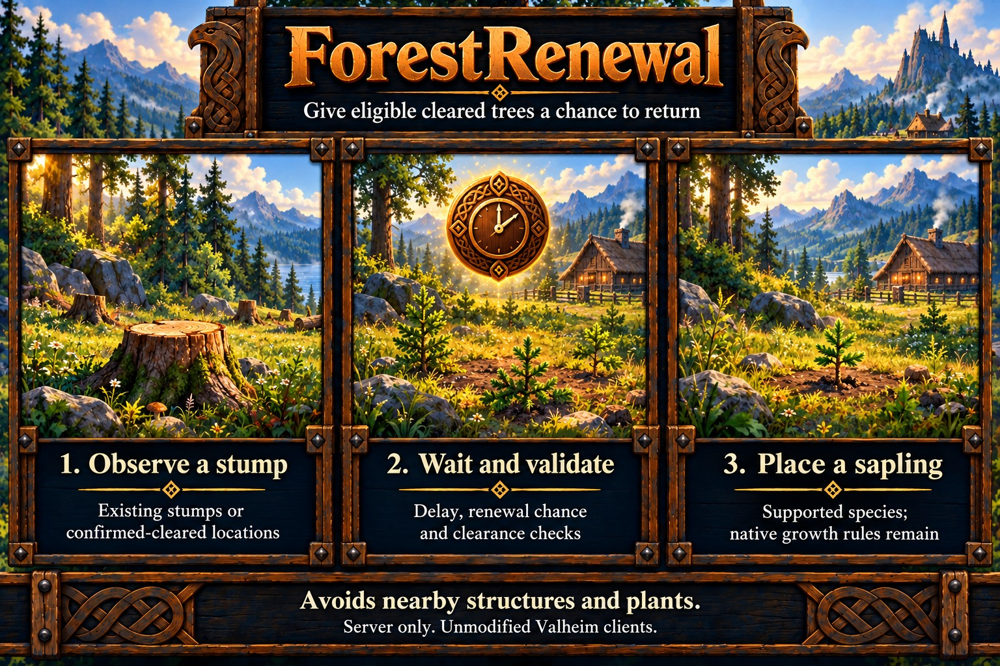

# ForestRenewal

Renews supported trees from either a stump left behind or its confirmed-cleared location. It finds existing/new stumps, waits, and has a configurable chance to replace the stump with the corresponding vanilla sapling. Removing a tracked stump keeps the same renewal timer and chance decision. Native biome, sunlight, spacing and growth rules remain.

Supported families are beech, birch, oak, fir, pine and the plantable large fir. Snow, ancient/swamp, Yggdrasil, Ashlands and decorative stumps are excluded. Exact tree/stump/sapling names belong in the [specification](../specs/forest-renewal.md).

With the defaults, each stump gets one 50% chance after five minutes. Old stumps start a full delay when first discovered; set ChancePercent=100 to renew every eligible stump. DelaySeconds only controls when the sapling is placed; its growth time stays vanilla.

Just before placing a sapling, renewal checks for player-built pieces within StructureExclusionMeters of their collision footprint (walls, floors, beams and every other piece; height separation does not help) and for any existing sapling or crop within PlantExclusionMeters, whoever planted it. Building or planting during the delay therefore blocks renewal, leaving the plant and any stump intact. Dirt, paved and cultivated ground is also avoided; native paint can identify cleared roads, but unpainted paths cannot be classified. A persisted cooldown of native world hours covers renewals within five horizontal metres.

Pending renewals and consumed decisions are stored beneath the active loader's config directory in `HeimKit/ForestRenewal/world-<world UID>.renewals`. Preserve this file and its backup with the world; see [world backups](../world-backups.md#forestrenewal-data). Corrupt or incomplete ledger recovery stops this feature. Native world time controls pending delays. The at-most-once persistence policy and crash behavior are described in [limitations](../limitations.md#new-world-features).

## Configuration

Use `[ForestRenewal]` in `heimkit.cfg`. This feature defaults enabled; set Enabled=false to disable it. Stop the server before editing and restart to apply settings. HeimKit preserves existing values and supplies missing defaults.

| Setting | Default | Purpose |
| --- | --- | --- |
| Enabled | true | Enable ForestRenewal. |
| DebugMode | false | Enable feature diagnostics through the shared debug policy. |
| DelaySeconds | 300 | Delay from first stump observation or confirmed removal. |
| ChancePercent | 50 | One renewal chance per original stump. |
| StructureExclusionMeters | 10 | Horizontal clearance from player-built piece footprints; zero disables it. |
| PlantExclusionMeters | 10 | Horizontal clearance from existing saplings/crops; configurable from 10 to 50 metres. |
| ExcludeClearedGround | true | Exclude dirt, cultivated and paved ground. |
| ExclusionRadiusMeters | 3 | Terrain paint exclusion radius. |
| LocationCooldownHours | 24 | Native world hours between renewals within five metres. |
| MaxPending | 1024 | Maximum pending renewals. |
| ScanRangeMeters | 64 | Processing range around a rotating ready player. |
| IntervalSeconds | 2 | Processing interval. |

Ranges and selection rules are in the [specification](../specs/forest-renewal.md). DebugMode follows the [shared debug/suppression policy](../server-setup.md#diagnostics).

## Diagnostics

Normal output groups confirmed results per completed pass and preserves failures and lifecycle notices. Optional Debug summaries describe changed current scope and result counts at most once per minute. `scope` counts pending renewals; `results` counts completed operations in the latest pass; `lifetime_results` counts them during the current controller lifetime. Counts restart when the controller is recreated. Empty unchanged scopes are quiet. Bounded decision samples identify standing-stump replacement, cleared-position planting, structure buffers, plant/tree/terrain/cooldown exclusion and unknown structure context, naming the blocking object and missing condition; unchanged blockers repeat at most once per five minutes. Stage timings separate scope scanning, structure checks, terrain preparation, background ledger writes and world mutation.

See [shared safety and delivery limitations](../limitations.md#new-world-features).

## HeimKit log topics

- `renewal`: Renewal decisions and durable ledger work.

Shared lifecycle, configuration, scope and timing topics follow the [logging contract](../architecture.md#logging). Verbose evidence requires effective debugging and the shared DebugVerbosity setting.
