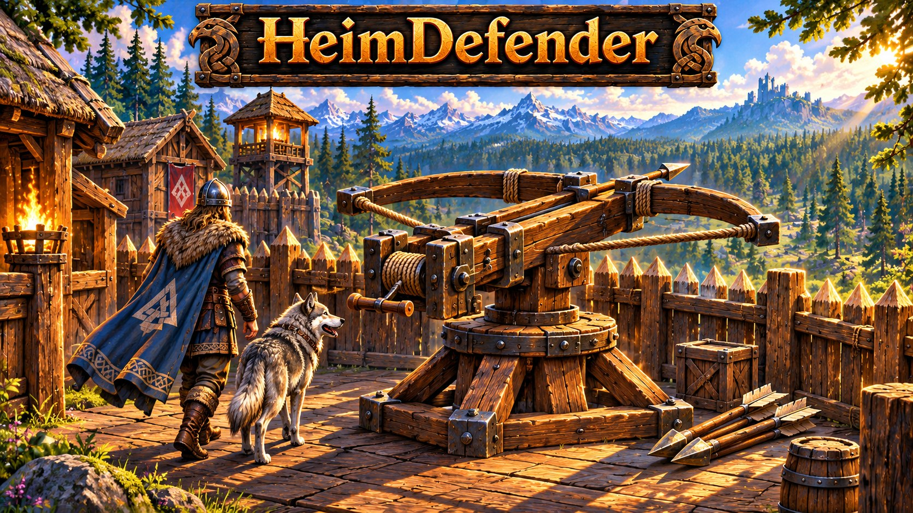

# HeimDefender

Open **F7 → Server Settings → HeimDefender** on the world host or as an authorized dedicated-server admin. **Enabled** defaults on. The host configures nearby player-built Ballistas to skip players and tames, including when a trophy is set. The host supplies these rules to vanilla and console guests.

**Free bolts** defaults off. Choose **Wooden** (default), **Black Metal**, **Flametal** or **Bloodgold** from **Bolt type** beside the switch. When enabled, the host tops up each eligible Ballista to the stock level selected under **Bolts per reload** (1 to 40, default 40), up to its magazine capacity. The hover counter shows the remaining stock. The reload quantity sets the delay before the next refill. When you change bolt type, the Ballista uses its remaining stock first. Turning free bolts off leaves loaded bolts available to fire.

**Debug logging** in Server Settings records policy refreshes and owner-reported targets. A player running HeimKit can enable **F7 → Client Settings → HeimDefender → Debug logging** to record the actual targeting fields on their Ballista instance, the target’s identity and faction, and the active ammunition type. Use the world, Ballista and target IDs to match entries between processes. Each logging control defaults off.

See the [targeting and ownership specification](../specs/heim-defender.md) and [gameplay limits](../limitations.md#heimdefender).
