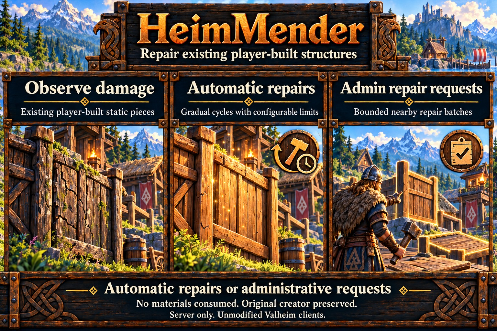

# HeimMender

Automatic background work pauses during native raids or observed combat; confirmation cleanup and explicitly requested administrative repair batches continue. See [performance observations](../server-setup.md#performance-observations).

Gradually repairs damaged player-built static structures and accepts bounded administrative repair requests. It restores existing pieces to native maximum health without consuming materials or changing their creator. Destroyed pieces and world-created ruins are excluded. See [specification](../specs/heim-mender.md) and [shared limitations](../limitations.md).

## Settings

Settings are in `[HeimMender]` in the loader-provided `heimkit.cfg`. This section reloads during play, including Enabled and DebugMode; other features keep their documented restart requirements. Save a complete edit and allow a few seconds for application. Invalid values retain the previously loaded section and produce a warning. The shared [persistent feature disable](../server-setup.md#persistent-feature-disables) overrides live Enabled changes after a disabling failure.

| Setting | Default | Purpose |
| --- | --- | --- |
| Enabled | true | Enable the module |
| DebugMode | false | Optional shared-policy diagnostics |
| AutomaticEnabled | true | Gradual repair cycles |
| IntervalSeconds | 300 | Seconds between automatic cycles while nothing is waiting |
| CatchUpIntervalSeconds | 15 | Seconds until the next cycle while damaged pieces are still waiting; 0 always uses IntervalSeconds |
| RepairChancePercent | 50 | Chance per damaged candidate per cycle |
| MaxRepairsPerCycle | 10 | Maximum automatic repair requests per cycle |
| ScanRangeMeters | 64 | Range around a rotating ready player |
| DamageQuietSeconds | 60 | Deferral after observed health loss |
| RepairSpreadSeconds | 1320 | Period over which automatic repairs are spread; each piece waits a random share of it after its last health loss; 0 disables |
| HostileClearanceMeters | 30 | Automatic deferral near untamed MonsterAI; 0 disables |
| AdminRadiusMeters | 64 | Default manual repair radius |
| AdminMaxPieces | 200 | Maximum requests per manual batch |
| RepairRequestId | 0 | Increase to request manual repairs during play |
| RepairTarget | empty | Exact joined player name or peer UID; empty requires one ready player |

Repairs never start while a piece is still taking damage or an untamed creature is nearby. Once those deferrals clear, cycles repeat at CatchUpIntervalSeconds until every waiting piece has been handled, then return to IntervalSeconds. Restoration is gradual. Each damaged piece waits its own random share of RepairSpreadSeconds after it last lost health, so a damaged base mends piece by piece over about 22 minutes with the default, close to a full game day. Lower the value for faster recovery or set it to 0 to repair as soon as the deferrals clear. Set CatchUpIntervalSeconds to 0 for fixed IntervalSeconds cycles. Chance and caps apply independently: a cycle may repair fewer pieces. Automatic damage/threat deferrals do not classify the original cause of damage. Manual batches bypass those deferrals, the repair spread, cycle timing and chance.

## Administrative repair

Set RepairTarget to the intended joined player, then increase RepairRequestId and save the config. The service repairs eligible pieces within AdminRadiusMeters of that player's observed position. Startup establishes the saved request ID as its baseline; it never replays a request. One batch runs at a time. An empty server, ambiguous target or busy batch rejects the request.

From the **dedicated-server terminal**, use `heimmender repair <peerUID-or-single-word-name> [radius]` or `heimmender status`. Configuration supports full player names containing spaces. Vanilla clients do not recognize this new console command. A normal server-routed `!heimmender repair` chat message also accepts requests from native server-list admins, using their authenticated connection and own position. See [native delivery limitations](../limitations.md).

## Scope and diagnostics

Player-built static building-category walls, floors, roofs, structural beams, doors and gates qualify, including weather-immune materials. Furniture, crafting stations, containers, vehicles and moving pieces are excluded. Repairs use the existing native owner; unavailable owners postpone work.

Normal output reports accepted/rejected requests and confirmed repair totals per completed batch. Debug scope summary records show damaged candidates, quiet/scheduled/threat deferrals, unavailable owners and selected requests. Request samples include ZDO identity, health, maximum health and owner; outcome sample records separate requests, confirmations and timeouts. A sent request alone is not a repair confirmation.

The observation budget retains damaged candidates rather than healthy building pieces. HeimMender follows a piece from the health change that leaves it below maximum; healthy pieces are not re-checked on each pass, so a fully repaired base adds almost no routine work. Completed repairs release their slots. Normal output warns if damaged-candidate capacity is exhausted and reports when capacity recovers.

## HeimKit log topics

- `repair`: Repair selection, requests and confirmations.

Shared lifecycle, configuration, scope and timing topics follow the [logging contract](../architecture.md#logging). Verbose evidence requires effective debugging and the shared DebugVerbosity setting.
