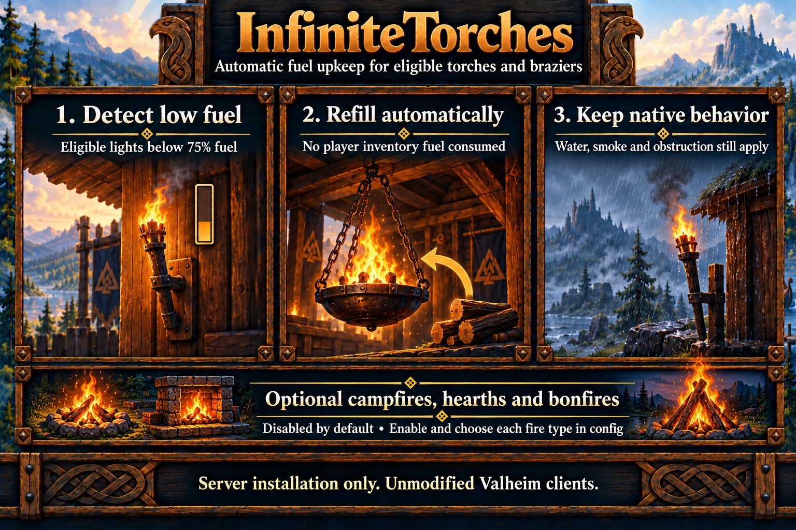

# InfiniteTorches

Automatically refills eligible torches and braziers to normal capacity without spending player inventory fuel, including brazier coal. Optional campfire, hearth and bonfire refilling defaults off and can be controlled by fire type.



See [server setup](../server-setup.md) for installation and shared settings, [safety and limitations](../limitations.md#weatherguard-and-infinitetorches) for operational limits, and the [specification](../specs/infinite-torches.md) for processing rules.

## Behavior

Below 75% fuel, the server sends a native refill request to the object's current owner. Pending-request tracking suppresses duplicates and retries unresolved requests after a timeout. Native on/off and environmental behavior remains active.

The default list includes wooden, iron, green, blue and wall torches, the hanging brazier, and both standing brazier variants. Campfires, hearths and bonfires (the large outdoor fire) are excluded by default. Set IncludeFireplaces to true to enable their refilling, then use Campfires, Hearths and Bonfires to choose individual types. A false master or type switch excludes those fires even if manually listed in Prefabs. Unsupported configured prefabs are skipped with a grouped warning.

## Configuration

Settings belong under `[Torches]`. Stop the server before edits and restart to apply them. Existing values are preserved.

| Setting | Default | Purpose |
| --- | --- | --- |
| Enabled | true | Enable automatic refilling. |
| IntervalSeconds | 5 | Refill interval; 2–60 seconds. |
| MaxMessagesPerPass | 32 | Request budget; 1–256. |
| IncludeFireplaces | false | Master switch for campfires, hearths and bonfires. |
| Campfires | true | Refill campfires when IncludeFireplaces is true. |
| Hearths | true | Refill hearths when IncludeFireplaces is true. |
| Bonfires | true | Refill bonfires when IncludeFireplaces is true. |
| Prefabs | Default torch/brazier list | Comma-separated candidate prefab names. |
| DebugMode | false | Feature diagnostics through the [shared debug policy](../server-setup.md#configuration). |

To add braziers to an older retained list, append `piece_brazierceiling01,piece_brazierfloor01,piece_brazierfloor02` to Prefabs. New configurations include them automatically.

The individual fire switches default to true but have no effect until IncludeFireplaces is enabled. They do not change torch or brazier refilling.

For example, to refill only hearths among these fire types:

```ini
[Torches]
IncludeFireplaces = true
Campfires = false
Hearths = true
Bonfires = false
```

## Diagnostics

Info groups observed fuel increases into one result per pass. Empty/unchanged passes stay quiet. Debug includes candidates, requests, skip reasons, pending records and deferred work; refill-request details are capped at four per minute. See the [logging contract](../architecture.md#logging) for shared formatting and budgets.
