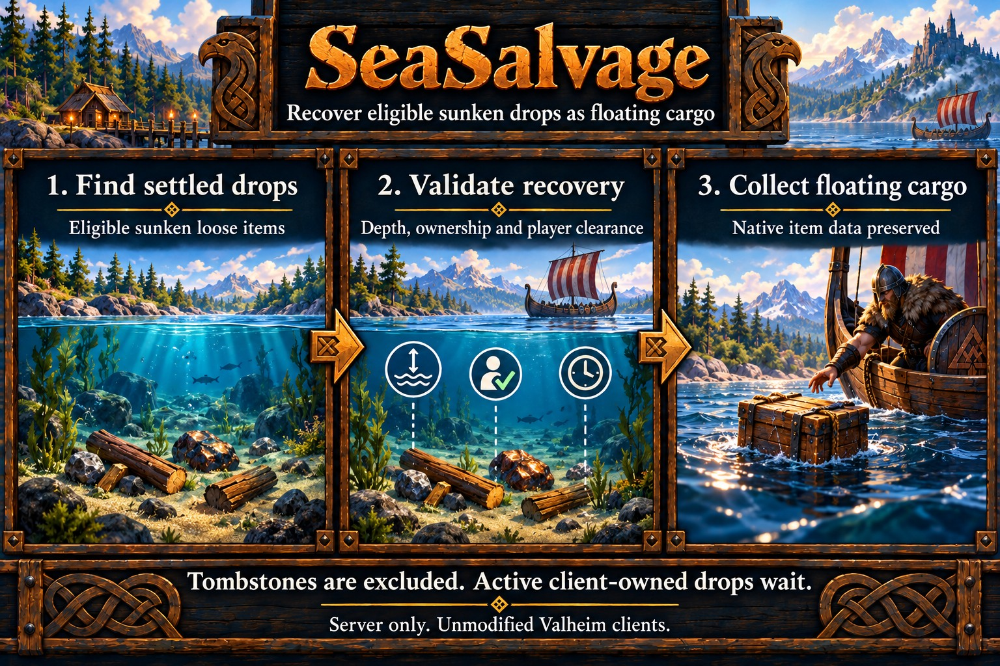

# SeaSalvage

Moves eligible inaccessible sunken loose item drops into ordinary floating cargo crates. Tombstones, placed items, creatures, fish, already floating drops and unsupported definitions are excluded.

The vanilla CargoCrate has four inventory slots. Each source occupies a separate slot, preserving its full native item data without stack merging. Crates group nearby drops during one processing batch; published crates are never reopened for additional salvage. Cargo can be opened, drift, break and release items through normal gameplay.

Defaults require four to fifty metres of water depth and thirty seconds of unchanged source state, with no living player within ten metres. Recovery scans within 128 metres of a rotating ready player. Active client-owned drops wait for native ownership release. Unknown terrain/water or source state defers recovery.

## Configuration

Use `[SeaSalvage]` in `heimkit.cfg`. This feature defaults enabled; set Enabled=false to disable it. Stop the server before editing and restart to apply settings. HeimKit preserves existing values and supplies missing defaults.

| Setting | Default | Purpose |
| --- | --- | --- |
| Enabled | true | Enable SeaSalvage. |
| DebugMode | false | Enable feature diagnostics through the shared debug policy. |
| MinimumDepthMeters | 4 | Minimum item depth beneath native water. |
| MaximumDepthMeters | 50 | Maximum salvage depth. |
| DelaySeconds | 30 | Continuous unchanged source settling interval. |
| ScanRangeMeters | 128 | Range around a rotating ready player. |
| GroupRadiusMeters | 4 | Maximum horizontal distance from first grouped drop; zero means one per crate. |
| SlotsPerCrate | 4 | Whole drops per native four-slot crate. |
| MaxItemsPerPass | 16 | Maximum whole item drops transferred per pass. |
| IntervalSeconds | 2 | Processing interval. |

Ranges and selection rules are in the [specification](../specs/sea-salvage.md). DebugMode follows the [shared debug/suppression policy](../server-setup.md#diagnostics).

Existing configured values are preserved, so an older server keeps its previous ScanRangeMeters; set it to 128 to adopt the current default.

## Diagnostics

Normal output groups confirmed results per completed pass and preserves failures and lifecycle notices. Optional Debug summaries describe changed current scope and result counts at most once per minute. `scope` counts settling sources; `results` counts completed operations in the latest pass; `lifetime_results` counts them during the current controller lifetime. Counts restart when the controller is recreated. Empty unchanged scopes are quiet. Eligibility summaries report client_owned, player_near, settling, terrain_wait, depth_excluded and invalid_items. Bounded transfer samples pair source and cargo ZDO IDs.

See [shared safety and delivery limitations](../limitations.md#new-world-features).

## HeimKit log topics

- `salvage`: Sunken-item selection and cargo transfer.

Shared lifecycle, configuration, scope and timing topics follow the [logging contract](../architecture.md#logging). Verbose evidence requires effective debugging and the shared DebugVerbosity setting.
