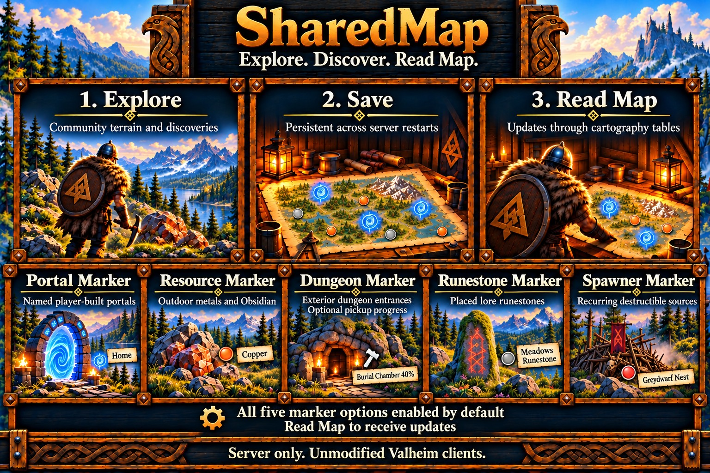

# SharedMap

SharedMap saves community exploration and discoveries, then shares them through vanilla cartography tables. Install HeimKit on the dedicated server; players use unmodified clients and choose **Read Map** to receive updates. Collection works before any table exists.

SharedMap and portal/resource/dungeon/runestone/recurring-spawner markers default enabled. Each source works independently. See [safety and limitations](../limitations.md#sharedmap) for discovery, client-update and upload limitations, and [server setup](../server-setup.md) for installation and shared settings.



## Shared exploration

Terrain is recorded around usable outdoor player positions using the native minimap radius and interval. Accepted table exploration is unioned with the community map, so a smaller upload never erases existing exploration. Readers receive it in vanilla's shared-exploration layer; personally explored terrain remains separate.

On first use without a saved community map, SharedMap imports valid exploration from existing saved tables, including distant tables. It saves the completed import before starting player capture. Later starts load the saved map.

## Portal Marker

Player-built portals in community-explored terrain receive portal-shaped markers. Labels use current portal tags, or `NoName` when blank; connected and unconnected endpoints qualify.

PortalClusterDistanceMeters groups endpoints around a fixed first portal. Groups display `Multi Portals (N)` at their centre; single portals keep their tag. Zero shows individual endpoints. Renames and removals are reconciled from current world records; small persistent publication offsets help refresh renamed markers.

While enabled, automatic portal management reserves every portal-icon pin in table data for actual portals. Other icons are preserved except matching nearby obsolete portal pins; automatic reconciliation preserves player-owned hammer pins. Disabling portal sync removes generated portal records and preserves player-owned pins.

## Resource Marker

Records outdoor Copper, Tin, Silver, Obsidian and static Flametal deposits with labeled dot markers. Scraps, dungeon resources, creatures, dropped items, ordinary stone and player-built objects are excluded.

Silver requires a direct pickaxe hit or a qualifying pickaxe impact near the nearest eligible vein. SilverDiscoveryRadiusMeters controls nearby impact discovery; direct hits select the struck vein. Travel, Wishbone pings and retrospective exploration do not unlock Silver.

ResourceClusterDistanceMeters groups the same resource type around fixed discovery anchors; zero shows each deposit. Tin groups show remaining discovered nodes, such as `Tin (3)`. Copper and Silver show remaining-section percentages, such as `Copper 65%`; `?%` means progress is unknown. Confirmed depleted nodes disappear when ResourceRemoveDepleted is true; false retains historical nodes.

ResourceMarkerHideDistanceMeters defaults to 10 metres. A generated resource marker or group at or within that horizontal distance of a published portal, dungeon, runestone or physical-spawner marker is hidden to reduce clutter. Resource discoveries, grouping and depletion tracking are retained; another resource marker does not hide it. The comparison uses final published map positions after marker exclusions and offsets. Resources can reappear when the nearby landmark marker is removed or its source is disabled. Set the distance to 0 to disable this display rule. Personal pins are preserved. See [client map updates](../limitations.md#client-map-updates) for existing personal-map copies.

ResourceDiscoverPreviouslyExplored also discovers eligible deposits in saved community-explored terrain without a revisit. Silver keeps its mining requirement. Turning the setting off retains accepted discoveries. Player-created dot pins keep their original records.

## Dungeon Marker

Records supported dungeon **exterior entrances** within the native exploration radius. Markers use the vanilla hammer/T icon and a short type label. Each gateway keeps its own saved discovery record. Shared tables publish one dungeon marker per fixed ten-metre anchor, suppressing nearby duplicates without deleting discoveries or world objects. DungeonLootProgress adds short remaining-pickup percentages where supported, such as `Burial Chamber 40%` and `Frost Cave 0%`. Arbitrary player hammer notes are preserved. Uploaded hammer pins using a recognized dungeon label, with or without a percentage, are removed within ten metres of a generated dungeon anchor so stale copies do not accumulate.

| Dungeon family | Marker label |
| --- | --- |
| Forest crypts | Burial Chamber |
| Swamp crypts | Sunken Crypt |
| Troll caves | Troll Cave |
| Mountain caves | Frost Cave |
| Mistlands mines | Infested Mine |
| Queen dungeon | Infested Citadel |
| Hildir crypt | Smouldering Tomb |
| Hildir cave | Howling Cavern |
| Morgen caves | Putrid Hole |
| Lord Reto's tomb | Reto's Tomb |
| Bear caves | Bear Cave |
| Winding tunnels | Winding Tunnels |
| Mörkhalla | Mörkhalla |

Only verified placed entrances qualify. Sealed Tower, ordinary buildings, disabled dungeon variants and the condition-controlled Prison entrance are excluded. The [specification](../specs/shared-map.md#automatic-dungeon-entrances) lists exact prefabs.

DungeonDiscoverPreviouslyExplored also discovers placed entrances whose exterior points lie in saved community-explored terrain. It scans gradually without generating locations or loading scenes. Disabling retrospective discovery retains accepted records. Disabling DungeonMarkerSync retains its store and removes generated dungeon pins during table normalization.

### Pickup percentages

Use `[SharedMap] DungeonLootProgress` to control pickup percentages independently of entrance markers:

```ini
[SharedMap]
DungeonMarkerSync = true
DungeonLootProgress = true
```

Set `DungeonLootProgress = false` to show plain dungeon names without percentages. Leave `DungeonMarkerSync = true` to keep the entrance markers. Existing discoveries, visits and saved progress are retained. Stop the server before editing the active `heimkit.cfg`, then restart to apply the setting.

| Dungeon | Tracked permanent pickup |
| --- | --- |
| Burial Chamber / Smouldering Tomb | Surtling Core stands |
| Infested Mine | Black Core stands |
| Frost Cave / Howling Cavern | Hanging Fenris Hair |
| Winding Tunnels | Frost Core pickups |
| Mörkhalla | Ancient gemstone pickups |

Percentages stay hidden until the server observes someone inside that dungeon or verifies that at least one tracked pickup has already been picked. Afterward, Read Map shares the remaining percentage with everyone. The percentage counts unpicked sites divided by the established placed total. All picked, or a supported dungeon with no tracked pickups, displays `0%`; unsupported or unknown inventories keep the ordinary label. Empty inventories may take an additional 30 seconds to establish after entry; a percentage already shown stays during that wait.

Visits and progress survive restarts. Existing saves without visit history unlock percentages after an observed entry or a fresh scan confirming already-picked items. Untouched or empty inventories alone do not establish a visit. Turning DungeonLootProgress off hides percentages while retaining discoveries, visits and saved progress.

### Shared X checkmarks

SharePinCheckmarks defaults false, keeping player X marks personal. Enable it with AllowPlayerMapWrites to share checked/unchecked changes through Write Map and Read Map across dungeon, portal, resource, runestone, spawner and ordinary player pins. For a grey shared marker, the first click makes it personal and the next toggles its X; Write Map shares the change. Manual X marks are independent of pickup percentages. Checkmarks and publication positions survive restarts in `.pin-state`. Percentage/checkmark changes use small publication offsets around the original source; see [client map updates](../limitations.md#client-map-updates).

## Runestone Marker

This source defaults enabled and shares separate vanilla dot markers for placed Boar, Greydwarf, Draugr and biome lore runestones. The [specification](../specs/shared-map.md#runestone-eligibility-and-placement) lists all eleven supported location prefabs. Stones qualify through their actual placed point; reading them is unnecessary. Boss trophy stones, Vegvisirs and decorative writing are excluded. Boar Runestones identify Meadows landmarks, not recurring boar farms.

Eligible placed stones inside saved community exploration are also discovered automatically. Disabling RunestoneMarkerSync retains discoveries and removes its generated table publications during reconciliation.

## Spawner Marker

This source defaults enabled and shares visible, player-destructible, stationary recurring spawner objects as vanilla dots. Supported sources include Greydwarf nests, both bone piles, Draugr piles, Charred stone/elite/event/cross sources, Jotun cores, Elaking single/double holes and Mork blob sources. Hidden creature-spawn points around dungeons, invisible recurring points, fish and Kvastur spawn instructions are excluded. The [classification table](../specs/shared-map.md#spawner-eligibility-and-classification) owns exact prefabs, labels and exclusions. One-shot points and incompatible legacy EvilHeart_Swamp are excluded.

Eligible physical source points inside saved community exploration are also discovered automatically. Saved markers for previously accepted hidden spawn points are omitted during table reconciliation; discovery history is retained. Accepted terminal source destruction hides its marker. Killing its creature or unloading the scene does not retire a source. Destruction history survives restarts. Disabling SpawnerMarkerSync retains history and removes its generated table pins during reconciliation.

If spawner markers are enabled but no compatible source types can be registered, SharedMap logs a warning that new spawner discovery is unavailable. SharedMap.DebugMode includes the effective switches, candidate count and grouped rejection reasons in the completed landmark audit.

RunestoneMarkerSync and SpawnerMarkerSync are the only settings for these two sources. All marker sources remain independent of one another, player-upload permissions and shared X marks. Use Read Map after table reconciliation to receive changes. See [discovery](../limitations.md#discovery) for interior/source-observation scope and [client map updates](../limitations.md#client-map-updates) for delivery.

## Allowing player map writes

AllowPlayerMapWrites controls player uploads. True accepts valid terrain and ordinary pins under SharedMap's filtering rules. False retains prior server-accepted map data while automatic exploration, generated markers and Read Map continue. Existing table pins and first-run import are preserved. See [upload limitations](../limitations.md#player-uploads) for vanilla UI behavior.

SharedMap changes only table map data. It preserves table ownership, creators, health, damage, repairs, wards and other world fields. Shared death pins are filtered; personal death markers remain native. Malformed incoming data is rejected in favor of prior data; malformed existing tables are left for review.

## Removing an unwanted shared pin

Beside `HeimKit/SharedMap/world-<world UID>.map` in the active configuration directory, create a UTF-8 file named `world-<world UID>.pin-admin.request`. Use the same world prefix as the map file. Put one command in it:

| Command | Action |
| --- | --- |
| `find Vile` | List up to 64 distinct exact-label matches at Info, including each pin's full ID, icon and coordinates. |
| `remove <pin ID>` | Persistently exclude that record and sweep saved tables. |
| `allow <pin ID>` | Remove the exclusion so future uploads are accepted. |

Copy the complete ID for the intended location. Removal targets owner, label, position and icon; other pins with the same label remain. Changing those fields creates a new identity. `allow` permits future uploads rather than recreating a deleted record.

Requests run with joined players and ready world services; no restart or DebugMode is needed. Accepted request files are deleted. Create a new file for another command. Invalid requests remain for correction and produce a warning. Ensure the filename ends in `.request`, not `.request.txt`. Read Map after the completed sweep and replication.

### Worked example: remove a pin named Vile

This procedure requires access to the dedicated server's files. Use the request file while SharedMap is enabled, the server is running and at least one player has joined the world. No server restart or DebugMode change is needed.

1. Locate the active `heimkit.cfg` using the configuration path logged at startup. For manager installations, use the active server profile; see [active configuration locations](../server-setup.md#shared-configuration-and-maintenance).
2. From that configuration directory, open `HeimKit/SharedMap`. Identify the current world's `.map` file. For example, if it is `world-0000000000000123.map`, the request filename must be `world-0000000000000123.pin-admin.request`. Use your actual world's prefix throughout.
3. Open the server's BepInEx console or active `BepInEx/LogOutput.log` so you can read SharedMap's administration messages.
4. In the same directory as the `.map` file, create the request file with a text editor. Save as UTF-8, select **All files** in the save dialog and use the exact `.pin-admin.request` filename. Enable File Explorer's **File name extensions** display to check that `.txt` was not appended.
5. Put only this line in the request file, then save and close it:

   ```text
   find Vile
   ```

   Replace `Vile` with the pin's complete, case-sensitive label when removing another item. Include spaces and any displayed percentage as part of the label; do not add quotation marks.
6. Wait for `Looking up table pins named "Vile"` and the lookup results in the log. Each `Table pin` result contains a full 64-character lowercase ID, icon, XYZ coordinates and owner. Compare the coordinates and icon to the item you intend to remove. If several pins have the same label, select the result for the intended location. Wait for `Pin lookup completed` before continuing.
7. Copy that result's complete pin ID. The accepted lookup request file disappears automatically. Recreate the same request filename containing one line:

   ```text
   remove <pin ID>
   ```

   Replace `<pin ID>`, including the angle brackets, with the actual ID copied from the log. Save and close the file.
8. Wait for `Removal rule enabled for pin` and then `Selected-pin cleanup sweep completed` in the log. The first message confirms the saved exclusion; the second confirms the table sweep finished. Review any warning about malformed tables separately.
9. After the sweep and replication, have players use **Read Map** at a cartography table to receive the updated shared data. For markers already copied to a personal map, follow [client map updates](../limitations.md#client-map-updates).

If the lookup reports zero matches, check the exact label, capitalization and current percentage. The lookup searches server-saved table pins, so a pin that exists only on a personal map is outside this lookup.

To undo the exclusion, recreate the same request file with `allow <pin ID>`, substituting the same actual ID. Wait for `Future uploads allowed for pin`. Future accepted uploads or automatic marker reconciliation can then publish that exact record again; the command does not recreate a deleted pin by itself. See [player uploads](../limitations.md#player-uploads) for X marks, source identity and personal-map behavior.

## Configuration

Settings belong under `[SharedMap]`. Stop the server before editing; restart to apply changes. Existing values are preserved and missing defaults are generated automatically. Updating does not turn an existing `RunestoneMarkerSync = false` or `SpawnerMarkerSync = false` into true; change those two values explicitly if you want to enable them in an existing configuration.

| Setting | Default | Purpose |
| --- | --- | --- |
| Enabled | true | Community exploration and table filtering. |
| PortalMarkerSync | true | Named player-built portal markers. |
| PortalClusterDistanceMeters | 60 | Portal anchor grouping distance; 0–100 metres, zero disables grouping. |
| ResourceMarkerSync | true | Outdoor metal and Obsidian markers. |
| ResourceDiscoverPreviouslyExplored | false | Discover eligible deposits in old community exploration. |
| ResourceClusterDistanceMeters | 30 | Same-type resource grouping; 0–100 metres, zero disables grouping. |
| ResourceMarkerHideDistanceMeters | 10 | Hide resource markers within this horizontal distance of another generated landmark; 0–100 metres, zero disables hiding. |
| SilverDiscoveryRadiusMeters | 10 | Nearest-vein discovery around a qualifying impact; 1–30 metres. |
| ResourceRemoveDepleted | true | Hide confirmed depleted deposits. |
| DungeonMarkerSync | true | Separate labeled exterior dungeon markers. |
| DungeonLootProgress | true | Show pickup percentages after observed entry or verified already-picked items. |
| SharePinCheckmarks | false | Accept shared X marks from allowed player uploads. |
| DungeonDiscoverPreviouslyExplored | false | Discover placed entrances in old community exploration. |
| RunestoneMarkerSync | true | Share eligible placed lore stones, including community-explored points. |
| SpawnerMarkerSync | true | Share eligible recurring sources, including community-explored points; hide confirmed destroyed sources. |
| AllowPlayerMapWrites | true | Accept player terrain/pin uploads; false retains server map data. |
| TableIntervalSeconds | 10 | Nearby reconciliation interval; 2–120 seconds. |
| MaxTablesPerPass | 1 | Table payloads per import/reconciliation/admin pass; 1–8. |
| SaveIntervalSeconds | 60 | Dirty-save interval; 10–600 seconds. Lifecycle transitions flush sooner. |
| PinDebugNameFilter | empty | Exact case-sensitive label for per-pin Debug details; counts include all labels. |
| DebugMode | false | Enable SharedMap diagnostics through the [shared debug policy](../server-setup.md#configuration). |

## Storage and recovery

Files live in `HeimKit/SharedMap` beneath the active BepInEx configuration directory. Each uses `world-<world UID in hexadecimal>` as its prefix.

| Extension | Saved state |
| --- | --- |
| `.map` | Community exploration and minimap geometry. |
| `.portal-pins` | Stable portal labels and publication positions. |
| `.resources` | Resource discoveries, depletion and mining progress. |
| `.resource-pins` | Resource publication labels and positions. |
| `.entrances` | Dungeon gateway identities, exterior coordinates, labels, visits and pickup progress. |
| `.runestones` | Placed lore-stone discoveries and actual source points. |
| `.spawners` | Recurring-source discoveries and terminal-destruction tombstones. |
| `.pin-state` | Shared checkmarks, source identities and marker refresh positions. |
| `.pin-removals` | Selected pin exclusions. |

Stores validate world identity, format, bounds and checksums. Dirty saves use flushed temporary files and atomic replacement, keeping the previous file as `.bak`. Accepted state is flushed on pause, world changes, failure and shutdown. Marker disablement retains discovery files. See [backup and recovery](../world-backups.md#sharedmap-data).

## Diagnostics

Info reports storage selection, completed first-run import, grouped discoveries/removals and table changes. Unchanged passes stay quiet. Failures remain visible with debugging off.

Debug adds native radius/cadence, supported dungeon prefab/gateway counts, discovery source and coordinates, mining evidence, publication choices and table pin changes. Dungeon proximity details include the original player sample and distance/radius. Pickup and saved-layout records name the dungeon, its location prefab, gateway and entrance position, and are written only when the result changes: pickup records give total/picked sites, remaining percentage and reason; layout records give room count, payload size and validity. Visit details distinguish observed interior entry from a prior visit inferred from matched picked items; empty-inventory evidence reports its settling state. Checkmark logs distinguish accepted uploads from publication changes. Storage details identify loaded and saved counts. Pin changes show owner, label, position, icon and replication sender when available. PinDebugNameFilter narrows per-pin details without changing totals or processing.

Discovery/publication details are capped at six per stream per minute; the [specification](../specs/shared-map.md#logging) owns the full limits. Shared debug configuration, loader filters and presence notices are described in [server setup](../server-setup.md#configuration).

## HeimKit log topics

- `exploration`: Community exploration capture.
- `portals`: Portal marker publication.
- `resources`: Outdoor resource discovery and retirement.
- `dungeons`: Entrance discovery and pickup progress.
- `landmarks`: Runestone and recurring-spawner observations.
- `tables`: Cartography table and pin reconciliation.
- `save`: Persistent state loading and saving.

Shared lifecycle, configuration, scope and timing topics follow the [logging contract](../architecture.md#logging). Verbose evidence requires effective debugging and the shared DebugVerbosity setting.
