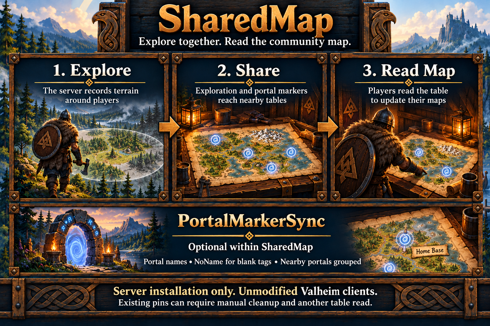

# SharedMap

SharedMap records exploration around server-observed players in one persistent community map. Collection starts without requiring a cartography table. Newly observed tables receive the community terrain, and accepted table writes are normalized on the server. Players retrieve the last replicated data using vanilla Read Map; no client installation is required.

SharedMap is enabled by default. PortalMarkerSync is its optional portal-management subfeature, also enabled by default. Turning off PortalMarkerSync leaves community exploration, persistence and death-pin filtering active. Existing configuration values are preserved on upgrade.

## Shared exploration

The native loaded Minimap supplies radius, pixel size, grid size and sampling interval. Exploration follows vanilla's pixel-circle calculation, regardless of camera visibility. Dead, unavailable and interior-height character observations are excluded. Sampling can miss travel between observations; teleport endpoints never reveal a connecting corridor.

Valid exploration already stored on a table or received in a table write is merged into the community map. Previously accepted terrain is not erased by a later writer with less exploration. Table terrain enters each reader's vanilla shared-exploration layer. That layer has no individual owner; personally explored terrain remains separate and the vanilla shared-map display toggle remains available.

## Table data

SharedMap fills table map data when native creation/replication paths observe the table and during bounded nearby reconciliation. A player does not first need to write a map. The server changes only the map-data field and lets native revisions and replication distribute it. SharedMap does not take network ownership of tables, change their creators, or alter health, repair, destruction or wards.

Incoming accepted ZDO updates and server-local writes to the map field are filtered. Shared death pins are removed. Other supported pins, except managed portal records described below, retain their original owner, author, name, position and checked state. This does not remove personal death markers from a player's map and does not create copper, tin, cave or other resource/location pins beyond player-built portals.

Unsupported or malformed incoming map fields are rejected in favor of the prior field. Existing malformed tables are left intact for review. Ordinary Write Map still uploads saved personal pins as vanilla does; selective private-pin sharing is not included. Tables without portal markers use exploration-only native data. Portal markers use a reserved shared service owner, independently of table network ownership.

Normalization happens when the server accepts replicated state. A client can briefly retain its own unsanitized local write until a newer server revision arrives, and an early table read can precede initialization or replication. SharedMap cannot retroactively change a read already performed on a vanilla client. Field-change logs describe server state, not proof of delivery or a player map read.

## PortalMarkerSync

With PortalMarkerSync enabled, player-built portals in community-explored terrain are added automatically, including unconnected portals and saved portals far from players. Markers use the vanilla portal-shaped icon and the portal's tag as the name, without a special text prefix; blank tags use `NoName`. Portal records are discovered at the table scan interval and current names/positions are read from accepted server data. No player needs to use Write Map. Readers retrieve the markers using vanilla Read Map.

Eligibility uses the persistent community map, including terrain imported from older tables, rather than only the current session or current reader's travels. Portals in already explored terrain can therefore appear without anyone revisiting them. Terrain outside the community's explored area does not qualify.

PortalClusterDistanceMeters defaults to 60 metres. Nearby portals appear as one `Multi Portals (N)` marker at their centre, using the portal icon. Each group stays anchored to its first portal, selected in stable world-object order; portals must be within the configured horizontal distance of that anchor, so a chain of neighbours does not group a whole region. A group's span can reach twice the configured distance. A single portal keeps its tag. Set the distance to zero to show portals individually. Changes require restart.

Generated markers and every uploaded pin using the portal-shaped icon are managed portal data, regardless of their names or authors. Their names and positions are replaced by the current portal catalog; duplicates, old names, old locations and deleted portals do not remain in normalized table data. While PortalMarkerSync is enabled, reserve that icon for actual portals: a portal-icon pin used for a cave or another purpose will also be replaced in shared table data. Other icon types are preserved except for obsolete portal duplicates matching the current portal label (case-insensitive) within three horizontal metres of its published position. Disabling PortalMarkerSync removes service-owned generated pins as tables are normalized, while leaving terrain and player-owned pins intact.

Vanilla can keep an already present pin within one metre without updating its label when Read Map runs. PortalMarkerSync defaults true and works around this by shifting a renamed portal/group marker to another nearby publication position. A marker starts at the actual location; later label changes select a position more than 1.1 metres from the prior marker, at most about 2.83 metres from the actual portal or group centre. The portal itself never moves. Unchanged labels keep their chosen position across reads, reconnects and restarts. The rename workaround is always active while PortalMarkerSync is enabled.

This encourages vanilla to insert the renamed pin and remove the unmatched old shared pin during the same Read Map operation. Nearby other pins can still block insertion, personal pins are not forcibly removed, and a client missing enough renames can encounter a reused position. Deleted/recreated portal identities and regrouping can also affect replacement. The server cannot confirm client reads or force an automatic map refresh. Portal names/groups come from saved world records; publication slots are retained separately beside the terrain file.

## Reading updates and existing pins

Use **Read Map** at a vanilla cartography table to retrieve the data currently available there. Neither exploration nor portal changes force an automatic refresh of an open player map. Tables near usable players are reconciled periodically; when several tables are nearby, the configured per-pass limit spreads updates across passes. A distant table is refreshed when the server observes it through the supported update paths or it becomes a nearby candidate.

Vanilla can retain any saved pin within one metre of an incoming marker without updating its name or icon. Different players may see different results from the same table because each has different existing pins. Removing a stale duplicate locally and choosing Read Map again may be necessary, even after the server has corrected the table. Keep the vanilla shared-map display enabled when viewing community exploration.

Server cleanup removes matching nearby obsolete records from table data and uses a small persistent marker offset when needed to encourage replacement. It cannot inspect or erase a player's personal map. Ordinary Write Map still follows vanilla sharing behavior; SharedMap does not provide private-pin selection or guaranteed per-client replacement.

## Configuration

| Setting in SharedMap | Default | Meaning |
| --- | --- | --- |
| Enabled | true | Independent enable switch. |
| PortalMarkerSync | true | Automatically maintain explored player-built portals and correct managed portal markers. |
| PortalClusterDistanceMeters | 60 | Group portals within this horizontal distance of the first portal; 0 to 100 metres, zero disables grouping. |
| TableIntervalSeconds | 10 | Nearby table reconciliation interval, 2 to 120 seconds. |
| MaxTablesPerPass | 1 | Table payloads per first-run import tick or periodic reconciliation pass, 1 to 8; incoming writes and new tables use their native event boundary. |
| SaveIntervalSeconds | 60 | Dirty community-map save interval, 10 to 600 seconds. |
| DebugMode | false | Optional feature diagnostics. |

Stop the server before editing and restart to apply settings. The central loader preserves existing values and adds missing defaults. Radius and sampling interval come from the native component rather than a separate radar setting. SharedMap uses player-presence services without acquiring AFK tracking. Empty or unavailable presence removes its gameplay hooks and controller; accepted map data remains available for the next joined session.

## First startup

When this world has no saved community map, SharedMap first scans existing saved cartography tables across the world, including distant tables. It merges valid exploration into its own file before starting player capture. This read-only import can run with no players online and does not change table data. Invalid payloads are skipped with a startup warning.

Even if there are no tables or no exploration to import, an empty map file records completion. Later restarts load that file and skip the initial scan. An interrupted import is retried; an unreadable or corrupt existing community file remains an error.

## Storage and recovery

The community terrain lives in `HeimKit/SharedMap/world-<world UID in hexadecimal>.map` beneath the active BepInEx configuration directory. It is separate from the native world save and exists independently of tables. Its world identity and grid metadata are checked on load. Corrupt, unreadable, incompatible or truncated files disable SharedMap rather than starting an empty replacement.

The matching `.portal-pins` file retains marker names, publication slots and last published positions for the rename workaround. Its bounded records, world identity and checksum are validated before use. Missing state starts fresh; corrupt state or a missing primary file with a retained backup disables SharedMap rather than silently overwriting it. Both stores use the configured dirty-save interval and lifecycle flushes. A crash can lose publication choices since the last completed save.

Dirty data is saved periodically and flushed on empty/unavailable presence, world changes, failure and shutdown. Saves use a flushed temporary file and atomic replacement; the prior map is retained as `.bak`. Unchanged terrain does not trigger a disk write. A crash can lose observations since the last completed save. Saving accepted terrain and the first-run read-only import can run without joined players. Ordinary table reconciliation and new player exploration wait for joined players.

Include this map directory with the corresponding world backup, after stopping the server. Restore world and community data from the same backup point to avoid revealing exploration retained from a later world state. The file uses world UID rather than display name. A radius/interval change may retain existing pixels, but a different grid or pixel scale must not reinterpret them. See [world backups](../world-backups.md#sharedmap-data).

## Diagnostics

Startup, readiness and failures follow the shared logging contract. A completed first-run import reports tables found, valid payloads imported and explored pixels saved; invalid payloads produce one separate summary warning. Normal result messages group changed tables and removed shared death pins by completed incoming packet or reconciliation pass. Empty or unchanged operations stay quiet. Invalid existing tables and rejected incoming fields produce bounded warnings; storage failures disable only SharedMap and remain visible with debug off.

Opening a world's community store reports at Info whether an existing map loaded, including its explored-pixel count and skipped import, or an absent map triggered first-run import. Corrupt stores remain failures rather than triggering an import. These messages occur at world/store initialization, not on each player join or scan.

Optional Debug output identifies the selected world UID and community-file path at store initialization, and reports native geometry, current explored-pixel count, latest sampling/table scope and completed saves. See the [debug and hidden suppression contract](../server-setup.md#hidden-per-feature-debug-suppression), [technical specification](../specs/shared-map.md), [presence lifecycle](../architecture.md#required-feature-hookup) and [supported environment](../server-setup.md#supported-environment).

Debug publication details include old/new names, actual and published positions, chosen slot and distance from the previous marker. Separate table details include the table ID, data revision and update reason. Each stream is capped at six records per minute; these describe server decisions and field changes, not client delivery. Summaries distinguish new pixels from player circles and table imports since the current controller started; those counters reset when its gameplay controller is recreated. Refresh-state load/save evidence is also optional Debug output. Gameplay collection, slot selection and saving continue independently of debug settings.

Portal catalog Debug summaries report registered records, eligible explored portals, excluded records, resulting grouped marker count and clustering distance, bounded to one summary per minute. Separate removal details identify a marker's identity and prior label when it leaves publication state because it is no longer eligible or has regrouped, bounded to six records per minute. Removal evidence describes server publication state, not confirmed client cleanup.

Catalog summaries identify persisted community exploration as the eligibility source and include the native pin type. Up to six rotating publication samples per minute include marker identity, label, published position and icon type, so stable markers omitted by the initial change-event budget are observable over subsequent scans. These samples do not inspect personal client pins or confirm client rendering.

When Debug is enabled, table normalization reports preserved pins whose labels match generated portal labels without regard to case. Up to six records per minute identify the preserved icon, owner and position alongside the generated portal icon type. The evidence distinguishes removed nearby duplicates from preserved distant matching labels; it does not confirm client rendering.
