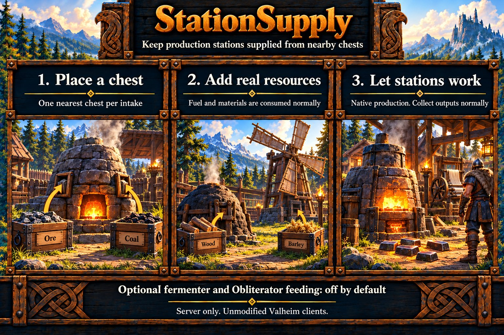
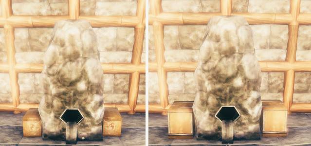
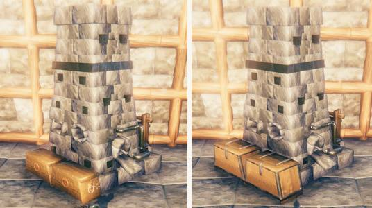
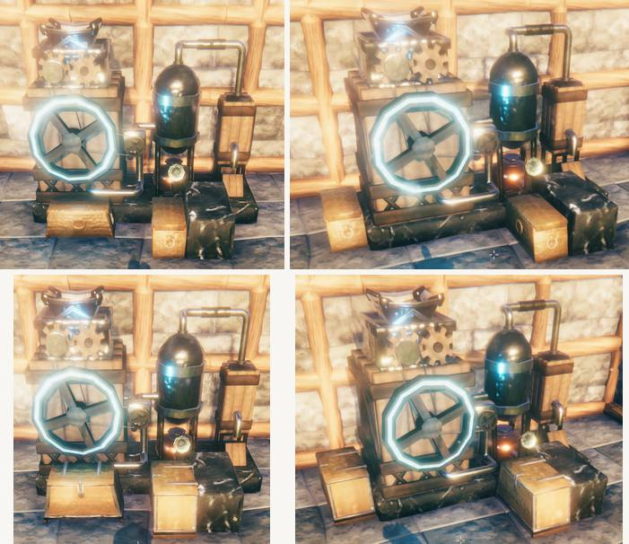
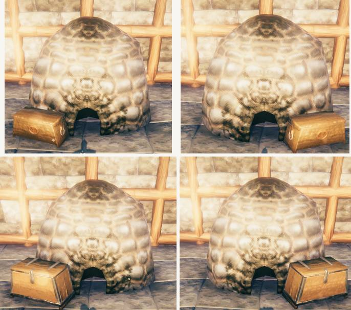
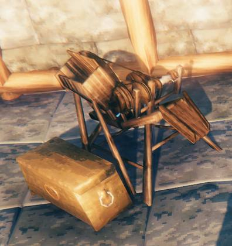
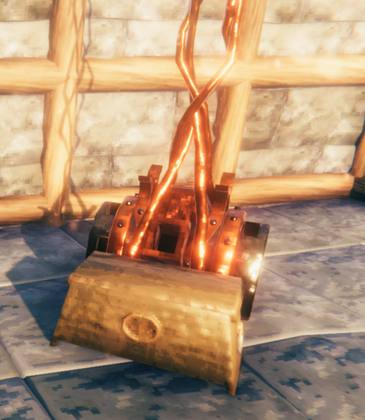
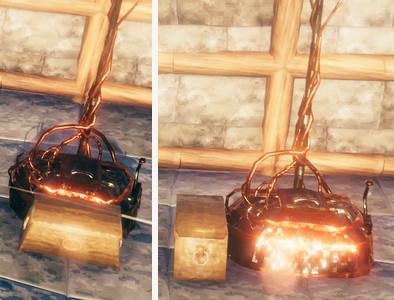

# StationSupply

StationSupply moves real resources from a nearby chest into a production station. It runs on the dedicated server with unmodified clients. See [supported environment](../server-setup.md#supported-environment), the [specification](../specs/station-supply.md) and [limitations](../limitations.md#stationsupply).



## Chest placement

Place a public stationary chest on the same floor as the station, just outside its **add-resource hatch**. Chest selection uses the chest's placement pivot, not its lid or nearest corner. The default horizontal reach is two metres from the actual intake; the chest pivot may be up to 1.5 metres above/below the station base. A good starting position is roughly half to one metre beyond the hatch's floor projection, leaving the hatch and output accessible.

### Placement examples

Use the loading prompt, output or lever to orient each station. Leave room to use the hatches and collect outputs.

#### Smelter



Face the output chute. Put ore or scrap on the left and coal on the right. The left photo shows the small chests, and the right photo shows the medium chests.

#### Blast furnace



Face the output side. Both loading slots are on your left. Put each chest beside its own slot and leave the output clear.

#### Eitr refinery



The sap funnel is just right of front center. Soft tissue loads at the upper-left grinder. A ladder or platform can help with manual loading. For StationSupply, put the soft-tissue chest on the floor at the left or front-left.

The top row shows small chests and the bottom row shows medium chests. Each row shows the front view followed by the view from the left.

#### Charcoal kiln



Put one chest just to either side of the wood-loading opening. The coal outlet is close to the loading point. The top row shows small chests and the bottom row shows medium chests.

#### Windmill


Use the barley-loading box at the base, on the opposite side from the flour outlet.

#### Spinning wheel



Put the chest beside the flax hopper. The wheel and output end help identify the correct side.

#### Frigid Kiln


Find the ice-loading prompt at the end opposite the output. Use the prompt to orient the kiln from your view.

#### Shield generator



Find the fuel-loading prompt at the base and place the chest just beyond it.

#### Fermenter (optional)


Put the chest beside the barrel within reach of its central loading point. Leave the tap clear for collecting mead.

#### Obliterator (optional)



Put a dedicated disposal chest beside the inventory opening and leave the lever accessible.

Each intake selects **one nearest chest** independently of what it contains. If that chest is empty, open, inaccessible or missing the correct resource, the intake waits. It never falls back to a farther chest or combines inventories. Put each chest closer to its intended hatch than other eligible storage. Chests on the inward side behind an off-centre hatch are excluded. Exact distance ties use stable object identity. One chest can feed more than one intake if it qualifies for each, including neighbouring stations.

Supported storage is ordinary player-built public wooden, reinforced, black-metal and grausten chests and barrels when their native definitions are available. Personal/private chests, wardrobes, carts, ships, cargo crates, tombstones and world loot are excluded. Enabled native wards require the station creator to have access at both source and station. Chests do not need a matching creator outside restricted areas.

## Behavior

StationSupply defaults enabled. Fill the supply chests with the intended resources and close their inventories. Each completed transaction transfers up to `MaxItemsPerVisit` compatible items into one intake in one atomic visit, respecting native capacity and conversion order. The default is ten; fermenters always take one input. Each moved material retains its own queue entry. A visit that fails before commit consumes nothing. Ownership handoff and bounded processing can delay feeding. Materials are consumed normally. Production speed, fuel cost, roof/wind/smoke checks and outputs remain native. StationSupply does not collect products, tap fermenters, supply fireplaces or feed during native sleep/time skipping. Fermenter filling requires native roof/cover readiness and defaults off.

Manual chest use takes priority. Opening, stacking into or taking all from a supported nearby chest pauses automation for that container for ten seconds. An observed open inventory extends that pause, leaving time to finish after closing it. When a request arrives during a transfer, StationSupply preserves the first request and yields after confirming current inventory state. If the item has already moved, it completes synchronization first, then passes the request to the native handler. The same priority applies to an enabled Obliterator's inventory. The intake keeps its selected chest throughout the pause. See [manual-access limitations](../limitations.md#stationsupply).

Nearby-object discovery is shared with HeimKit's other features. StationSupply prepares separate station/chest/ward selections, limits station candidates per visit and runs up to `MaxActiveTransactions` transactions at once (default two), over separate station and chest records. A shared chest or already-active station waits until its transaction ends. A chest confirmed to have no compatible or category-eligible input waits without another ownership handoff or inventory parse until its native data changes. Its nearest-chest assignment still blocks fallback. Ownership waits check nearby-player eligibility without repeatedly loading candidate lists; placement and access are checked again before transfer. See [performance scope](../specs/station-supply.md#performance) and [limitations](../limitations.md#stationsupply).

Players entering dungeons do not interrupt feeding at an outdoor station while another living player remains nearby. Discovery rotates between outdoor players, and an active transfer stays centered on its station. Each station with separate fuel/material intakes rotates its own loading order so other stations cannot keep one intake ahead of the other.

## Obliterator feeding

Obliterator feeding defaults **off**, with **All** item categories selected. Enable `Obliterators` to transfer unwanted items from the one nearest chest into the Obliterator. Place the supply chest beside the loading opening, preferably opposite the lever, and put the items you want to dispose of there. Pull the lever yourself when ready. Finished coal stays in the Obliterator for normal collection.

To narrow what transfers, edit `ObliteratorCategories` in the existing `[StationSupply]` section. Enable multiple categories by separating their names with commas, without quotes. Each selected category is included. For example, this supplies materials, trophies and ammunition:

```ini
[StationSupply]
Obliterators = true
ObliteratorCategories = Materials, Trophies, Ammo
```

Replace your existing setting lines rather than adding duplicate keys or another `[StationSupply]` section. A single category also works, for example `ObliteratorCategories = Trophies`. Use `All` by itself for every category or `None` by itself to transfer nothing. Restart after changing the file. Individual item names are not required. The full category list follows.

| Category | Includes |
| --- | --- |
| All | Every supported item category (initial selection). |
| Materials | Wood, stone, ores and other crafting materials, excluding recognized cooking/fermenting inputs. |
| Trophies | Creature trophies. |
| FoodAndMead | Edible items, fish, and inputs to native cooking stations/fermenters, including raw meat and mead bases. |
| Weapons | Swords, bows, staves and other native weapon types. Axes also match Tools. |
| Armor | Clothing, armor, capes and shields. |
| Tools | Hammers, hoes, pickaxes, axes and torches. |
| Ammo | Arrows, bolts and other native ammunition types. |
| Other | Utility items, trinkets and miscellaneous items. |
| None | Transfer nothing to Obliterators. |

Unselected categories stay in the selected supply chest; they do not block eligible items farther along in that same chest. A full or open Obliterator waits without consuming source items. Feeding waits around observed manual lever cycles. Category choices apply to feeding; the vanilla lever processes everything currently inside normally. See [limitations](../limitations.md#stationsupply).

## Configuration

Settings belong in `[StationSupply]` in the generated `heimkit.cfg`. Set `Enabled = false` to disable every StationSupply intake, or use the family switches below to choose which stations receive supplies. Restart after edits. Existing values are preserved and missing keys are added automatically. Shared/non-feature sections remain before feature sections.

| Setting | Default | Meaning |
| --- | --- | --- |
| Enabled | true | Enable StationSupply. |
| DebugMode | false | Optional diagnostics through the [shared policy](../server-setup.md#hidden-per-feature-debug-suppression). |
| ChestRangeMeters | 2 | Horizontal reach from the actual input (0.5–4 metres). |
| ChestHeightToleranceMeters | 1.5 | Chest-pivot height tolerance relative to the station floor (0.25–3 metres). |
| ScanRangeMeters | 64 | Processing radius around a rotating ready player (16–128 metres). |
| IntervalSeconds | 2 | Discovery interval (0.5–10 seconds). |
| MaxStationsPerPass | 4 | Maximum station candidates considered per discovery pass (1–16). |
| MaxItemsPerVisit | 10 | Maximum items per atomic intake visit (1–64), limited by native room; fermenters take one. Set to 1 for single-item visits. |
| MaxActiveTransactions | 2 | Maximum simultaneous transactions (1–4), using disjoint station/chest records. Set to 1 for one transaction at a time. |
| Smelters, CharcoalKilns, BlastFurnaces, Windmills, SpinningWheels, EitrRefineries, FrigidKilns, ShieldGenerators | true | Independently enable each family. |
| Fermenters | false | Fill empty sheltered barrels; finished mead remains manual. |
| Obliterators | false | Supply the Obliterator from one nearby chest; lever activation stays manual. |
| ObliteratorCategories | All | Choose All, None or a comma-separated combination of the item categories above. |

## Diagnostics

Confirmed resource moves are combined into a nonempty count once per minute, with pending moves reported when processing stops. Native reconnect/send suspension and unavailable source revisions defer ownership work before the station is acquired. Repeated unchanged handoff failures back off from four to thirty seconds; changed source readiness resumes on an ordinary discovery visit. Paired client refreshes combine native destruction and acknowledgement work while retaining both original records and all ready clients. See the [performance contract](../specs/station-supply.md#performance).

Normal output reports enabled/disabled state, Ready, grouped completed transfers and actionable failures. Timeout and invalid-inventory warnings identify the affected station/intake/chest, last observed stage and whether a transfer already committed. These warnings remain available with debugging off or its detail allowance exhausted. Unchanged incidents receive at most one reminder per five minutes; a completed transfer with confirmed native refresh reports recovery once. Runtime errors retain the existing feature-failure protection.

Set `DebugMode = true` in the existing `[StationSupply]` section to enable its optional diagnostics. For expanded evidence, also set `DebugVerbosity = Verbose` in the existing `[Diagnostics]` section. Verbose does not enable debugging by itself. Restart after edits; the [shared policy](../server-setup.md#hidden-per-feature-debug-suppression) still applies.

`StationSupply.supply` identifies station/chest object IDs, intake and the specific reason for waiting or cancellation. `selected_*` measurements describe the chosen chest; `rejected_candidate`, `rejected_reason` and `rejected_*` measurements describe other storage that failed placement rules. A rejection shown beside a working selected chest is not a failed transfer. `selection_checked = false` means selection was not performed; count fields are omitted when `selection_counts_measured = false`. Full stations can therefore report unmeasured selection without implying that no nearby chest exists. `record_in_active_transaction` identifies a station or selected chest already in another transaction. Terminal evidence includes the batch size. Other reasons distinguish open/empty storage, incompatible resources, category filtering, malformed inventories, ward denial, native ownership waits, fermenter cover and Obliterator quiet/busy states. Verbose adds positions, limits, measured rejection counts, accepted resources/categories, sampled rejected item names, owner/revision state and pending refresh peers. Inventory stack counts describe the inventory parsed for that transaction; they are not item quantities. Raw inventories and custom item data are not logged.

`StationSupply.config` reports enabled native station families and placement settings. `StationSupply.scope` reports observed station/chest counts and omitted optional attempts by stream. Twelve detailed records per minute are divided into six blocked conditions, four terminal outcomes and two progress samples, so progress cannot consume the outcome allowance. Successful stages use a nonempty activity summary at most once per minute. This reports committed transfers, transaction starts, cancellations, failures, source-state requests, cache-reset calls, completed refresh groups and blocked-check counts since the previous report; Verbose also reports ordinary state-snapshot calls and deferred manual requests queued, yielded, replayed or unavailable. `selected_chest_manual_grace`, `obliterator_manual_grace` and `manual_container_priority` distinguish manual-use deferral from ordinary open storage; `manual_request_expired`, `manual_request_unsafe` and `manual_request_unavailable` count requests that could not be replayed. Counts continue when optional records are suppressed, and blocked-check counts describe repeated checks, not unique failures or lost items. Identical reasons from different station/intake/chest combinations remain distinct. See [observation and delivery limitations](../limitations.md#stationsupply).

With effective debugging enabled, `StationSupply.timing` reports scheduled processing-pass count, average milliseconds, maximum milliseconds and observed scope at most once per minute. Stage records in the same window separate world discovery, chest selection, ownership, inventory parsing, commits, client refresh, native context checks and diagnostic output. `diagnostic_fields` narrows admitted evidence preparation before formatting/listener dispatch. Each includes calls, average milliseconds and maximum milliseconds. Network wait duration remains in supply evidence. Feature timing collection is disabled with debug suppression and does not add work on unscheduled ticks. The shared [performance window](../server-setup.md#performance-observations) supplies update, native context and logger measurements in global Verbose Debug. The [measurement boundaries](../limitations.md#server-observations-and-logs) explain interpretation.
