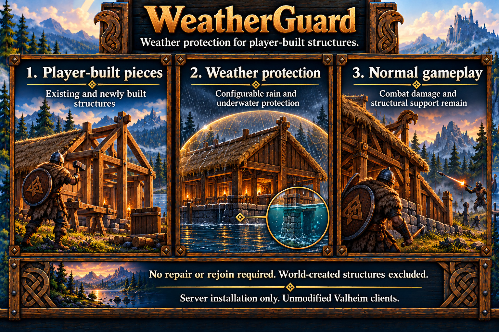

# WeatherGuard

Protects existing and newly player-built structures from configured weather wear while preserving their creators. Activation is automatic during play; repair, logout and rejoin are not required. Combat damage, repair, removal and structural support remain native.

See [server setup](../server-setup.md), [safety and limitations](../limitations.md#weatherguard-and-infinitetorches), and the [specification](../specs/weather-guard.md).

## Scope and configuration

Eligible pieces are static player-built structural categories with native weather wear. World-created structures, containers, moving objects, non-building categories and already weather-immune materials are excluded. Repairing a world-created piece does not claim it.

Settings belong under `[WeatherGuard]`. Stop the server before editing and restart to apply changes. Existing values are preserved.

| Setting | Default | Purpose |
| --- | --- | --- |
| Enabled | true | Enable automatic protection. |
| ProtectRain | true | Suppress eligible rain wear. |
| ProtectUnderwater | true | Suppress eligible underwater wear. |
| ExcludedPrefabs | empty | Exact case-sensitive prefab identifiers, comma-separated. |
| DebugMode | false | Feature diagnostics through the [shared debug policy](../server-setup.md#configuration). |
| DebugLogLevel | Detailed | Medium gives path summaries; Detailed adds counters and representative observations. |
| LogWorldCreatedItems | false | Include world-created diagnostic controls without protecting them. |

With both protection channels off, WeatherGuard acquires no pieces. An unprotected wetness source retains native processing when channels overlap. ExcludedPrefabs accepts letters, digits and underscores; invalid/over-limit entries produce a warning while valid entries remain. Snow, lava and other biome hazards retain native behavior.

## Coverage report

Use the [local request file](../server-setup.md#requested-weatherguard-coverage) for an Info report, including when debugging is off or the module is paused/disabled. It describes recently retained ready-player regions.

| Field | Meaning |
| --- | --- |
| eligible | Records selected by current policy. |
| protected | Eligible records with a loaded server instance, support context and current server ownership. |
| waiting | Eligible records awaiting instance, terrain, surrounding objects, capacity or ownership. |
| skipped | Other nearby records, grouped by exclusion reason. |

Eligible equals protected plus waiting within the reported scope. The report includes scan age, capacity and configured channels.

## Diagnostics

Info combines confirmed weather-contribution prevention into one nonempty ten-minute roll-up. One distinct affected piece is named; several pieces produce a combined count. Pausing, failure or shutdown flushes pending prevention once with the window start time. Capacity reduction and recovery remain separate notices.

Medium Debug explains eligibility, management and native processing gates. Detailed adds startup settings, ownership/loading/network counters, representative wetness/roof/timer/health observations and acquisition/release totals. Changed health loss and errors remain visible; unchanged health stays quiet.

Roof fields describe their sample size, age and unchecked/stale counts. Piece/player biomes and server wetness provide context. The [specification](../specs/weather-guard.md#exposure-counts-and-biome-evidence) defines these fields and budgets.

When a native damage, repair or removal handler runs on a protected piece, the `wear` record names the handler and its `command` and reports health before and after. These are hits, repairs or removals, not weather wear.

## HeimKit log topics

- `protection`: Eligibility, context and protection processing.
- `ownership`: Observed ownership and release.
- `wear`: Native wear and command outcomes.
- `rain`: Sampled wetness and health observations.
- `coverage`: Explicitly requested coverage evidence.

Shared lifecycle, configuration, scope and timing topics follow the [logging contract](../architecture.md#logging). Verbose evidence requires effective debugging and the shared DebugVerbosity setting.
