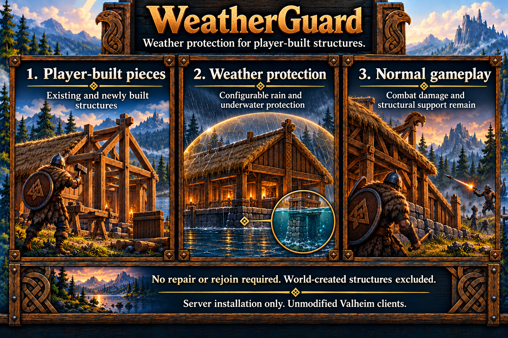

# WeatherGuard

Protects existing and newly player-built structures from configured weather wear while preserving their creators. Activation is automatic during play; repair, logout and rejoin are not required. Combat damage, repair, removal and structural support remain native. Protection scans advance in small batches across server updates, while already-managed structures retain protection between batches. Native terrain and scene coverage continue. Neighborhood readiness is reused until relevant dependencies or scene bindings change; optional geometry observations run separately from protection scans.

See [server setup](../server-setup.md), [safety and limitations](../limitations.md#weatherguard-and-infinitetorches), and the [specification](../specs/weather-guard.md).

## Scope and configuration

Eligible pieces are static player-built structural categories with native weather wear. World-created structures, containers, moving objects, non-building categories and already weather-immune materials are excluded. Repairing a world-created piece does not claim it.

Protection waits for nearby terrain, roof and support geometry, and shields to load. Unloaded drops or creatures outside the game's roof/support collision layers do not interrupt protection unless they provide structural support or shielding. Items with a wear component but no support function are treated the same way.

Settings belong under `[WeatherGuard]`. Stop the server before editing and restart to apply changes. Existing values are preserved.

| Setting | Default | Purpose |
| --- | --- | --- |
| Enabled | true | Enable automatic protection. |
| ProtectRain | true | Suppress eligible rain wear. |
| ProtectUnderwater | true | Suppress eligible underwater wear. |
| ExcludedPrefabs | empty | Exact case-sensitive prefab identifiers, comma-separated. |
| ReuseSceneLists | true | Reuses extra scene-list candidates between frames. Set false to query each frame. Restart after editing. |
| DebugMode | false | Feature diagnostics through the [shared debug policy](../server-setup.md#configuration). |
| DebugLogLevel | Detailed | Medium gives path summaries; Detailed adds counters and representative observations. |
| LogWorldCreatedItems | false | Include world-created diagnostic controls without protecting them. |

With both protection channels off, WeatherGuard acquires no pieces. An unprotected wetness source retains native processing when channels overlap. ExcludedPrefabs accepts letters, digits and underscores; invalid/over-limit entries produce a warning while valid entries remain. Snow, lava and other biome hazards retain native behavior.

## Coverage report

Use the [local request file](../server-setup.md#requested-weatherguard-coverage) for an Info report, including when debugging is off or the module is paused or disabled through configuration. A [persistent failure disable](../server-setup.md#persistent-feature-disables) also stops request polling. The report describes recently retained ready-player regions.

| Field | Meaning |
| --- | --- |
| eligible | Records selected by current policy. |
| protected | Eligible records with a loaded server instance, support context and current server ownership. |
| waiting | Eligible records awaiting instance, terrain, surrounding objects, capacity or ownership. |
| skipped | Other nearby records, grouped by exclusion reason. |

Eligible equals protected plus waiting within the reported scope. The report includes scan age, capacity and configured channels.

## Diagnostics

WeatherGuard remains active during raids and detected battles: required protection, support and terrain upkeep continue; optional exposure probes can wait. Extra scene creation focuses on protection dependencies and server-owned objects. Core repairs stale scene bindings without deleting saved objects and reports grouped warnings with example identities. See [shared performance observations](../server-setup.md#performance-observations).

Outdoor terrain loading excludes dungeon player positions. Native zone creation and lifetime refresh retain their existing cadence. The shared [performance window](../server-setup.md#performance-observations) reports native context cost and retained region counts without enabling Debug; terrain compiler creation waits for its own ready heightmap. See [observation limits](../limitations.md#server-observations-and-logs).

Info combines confirmed weather-contribution prevention into one nonempty ten-minute roll-up. One distinct affected piece is named; several pieces produce a combined count. Pausing, failure or shutdown flushes pending prevention once with the window start time. Capacity reduction and recovery remain separate notices.

Medium Debug explains eligibility, management and native processing gates. Detailed adds startup settings, ownership/loading/network counters, representative wetness/roof/timer/health observations and acquisition/release totals. Changed health loss and errors remain visible; unchanged health stays quiet.

Roof fields describe their sample size, age and unchecked/stale counts. Piece/player biomes and server wetness provide context. The [specification](../specs/weather-guard.md#exposure-counts-and-biome-evidence) defines these fields and budgets.

When a native damage, repair or removal handler runs on a protected piece, the `wear` record names the handler and its `command` and reports health before and after. These are hits, repairs or removals, not weather wear.

## HeimKit log topics

- `protection`: Eligibility, context and protection processing.
- `ownership`: Observed ownership and release.
- `wear`: Native wear and command outcomes.
- `rain`: Sampled wetness and health observations.
- `coverage`: Explicitly requested coverage evidence.

Shared lifecycle, configuration, scope and timing topics follow the [logging contract](../architecture.md#logging). Verbose evidence requires effective debugging and the shared DebugVerbosity setting.

Shared [player performance context](../server-setup.md#performance-observations) can correlate nearby eligible/protected structures and native rain/underwater wear observations with player location and combat evidence. It uses existing processing rather than additional geometry or water probes.

Optional [arrival diagnostics](../server-setup.md#performance-observations) correlate existing processing with player arrivals. They report passive protection or table-work observations without changing this feature's behavior.

WeatherGuard receives immediate occupied activation ahead of optional startup work. Required protection, native terrain lifetime and support processing retain their existing admission and cadence.
