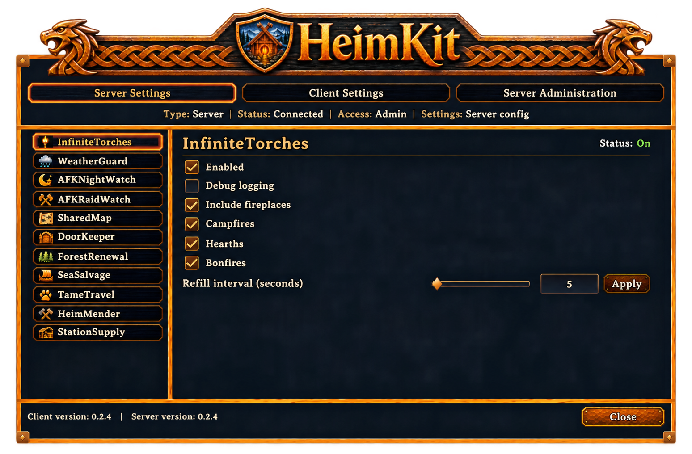
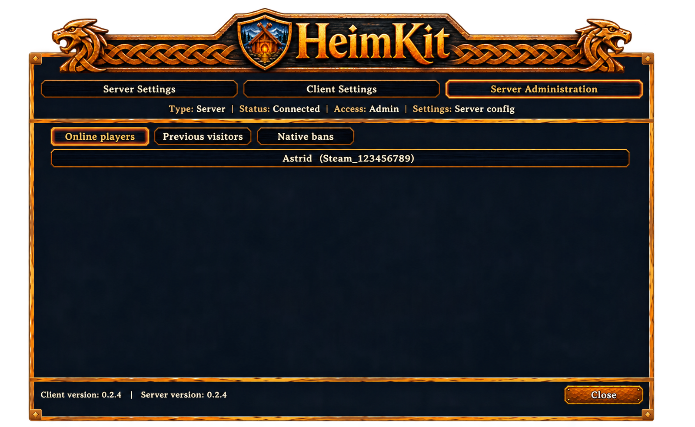
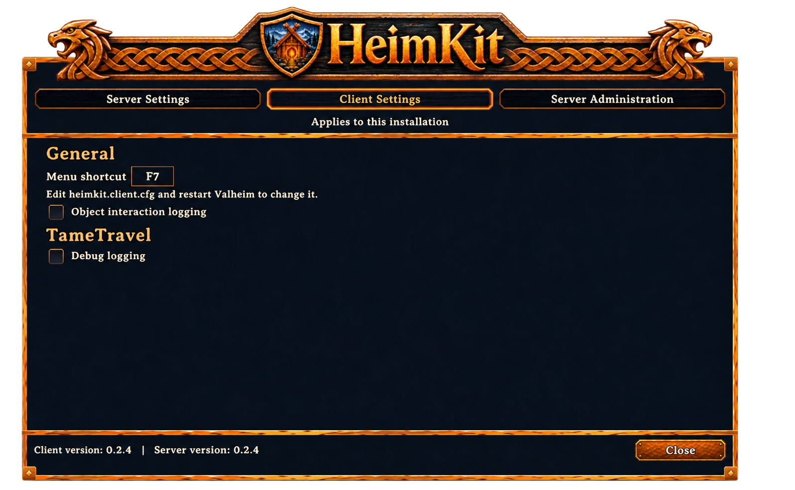

# HeimKit Settings

Press **F7** in Valheim to open **HeimKit Settings**. Choose **Server Settings** to see what is running in the world you are playing. Choose **Client Settings** to record container interactions on your own PC or see which key opens the menu.

## Open the menu

1. Launch Valheim with [HeimKit installed in the Windows game](client-setup.md). Load a world or join a server and wait for your character to appear.
2. Close the native menus and press **F7**. Press **Close**, **F7** or **Escape** to dismiss the panel.
3. Choose **Server Settings** for gameplay or **Client Settings** for local diagnostics and the menu shortcut. If you host the world or have dedicated-server admin access, choose **[Server Administration](#moderate-players)** for player history and bans.

*Server Settings in the F7 menu, as seen by a dedicated-server admin.*

## See which settings you can change

Check **Type**, **Status**, **Access** and **Settings** at the top of **Server Settings**. The **Settings** field identifies the configuration in use or indicates why gameplay settings are unavailable.

| Session | What you can do |
| --- | --- |
| **Local world** | If you opened a private world, you can edit that world’s settings once HeimKit is ready. |
| **Hosted world** | If you opened a world with **Start Server**, you can edit that world’s settings. Guests have no F7 access to the host’s settings. |
| **Server** | On a compatible dedicated server with HeimKit client support enabled, you can view settings. To edit them, your account must be on Valheim’s admin list and the server must allow admin changes. |

**Admin** means edits are allowed. **Read-only** means edits are unavailable. A server without compatible HeimKit support can still be played with the **Client Settings** tab available. For protocol mismatches and readiness, see [client limitations](limitations.md#heimkit-settings).

## Moderate players

Open **F7 → Server Administration** on a world you host or a HeimKit dedicated server where your account is on Valheim’s admin list and client support is enabled. **Online players** and **Previous visitors** show the latest observed character name alongside each account ID. The host records vanilla and HeimKit players from character entry, even while every admin is offline. **Native bans** includes existing Valheim entries for accounts or names the host has never seen.

Select a player, check the displayed name and account ID, then choose **Ban** or **Cancel**. To remove a ban, select its exact entry under **Native bans** and confirm **Unban**. Both actions work while the player is offline. Valheim enforces the list. A session without a platform account ID can be viewed only.

Dedicated admins can still view the lists when `[Client] AllowAdminChanges` is off. Removing an account from Valheim’s admin list closes its administration view on the next authorization check. In a private or Start Server world only the local host gets this tab. History is stored in `heimkit.players` beside the active server or world configuration. Player-hosted worlds each have their own history. Valheim’s native ban list follows the game's save profile.

## Change a setting

1. In **Server Settings**, select a feature in the sidebar. **On** and **Off** show the host’s reported state. **Disabled after error** means the host stopped the feature, even if its saved **Enabled** box is checked. See the host’s HeimKit log for the cause. **Unavailable** shows a reason when the feature cannot run. Scroll the settings pane to see additional controls.
2. Hover over a setting’s label for details. Click a switch to submit the change. For a numeric setting, click a position on the track, drag the gold thumb or type a whole number, then click **Apply**. The tooltip gives the accepted range and when the new value takes effect. Existing fractional values may appear rounded in the menu and stay in effect until you submit a new value.
3. Check the control for the applied value or a message. **Waiting for current work to finish…** means the current value stays in effect until the feature reaches a safe point to apply the change. If the feature reports that it was busy, try again after the current work finishes.

Applied changes save to the [active world or server configuration](client-setup.md#configuration-locations). The menu shows the settings that HeimKit exposes for in-game editing. See the [feature guides](../README.md#features) for the full settings list and when changes take effect.

**Server Settings → Debug logging** changes the selected feature’s logging on the world host. On a dedicated server, look in the server’s BepInEx log. In a world you host from Valheim, look in your game’s BepInEx log. Global debug settings, suppression and log filters still apply. See [client limitations](limitations.md#heimkit-settings) for restart behavior when changing gameplay switches.

## Gameplay controls in Server Settings

Every feature has **Enabled** and **Debug logging** switches. The table lists the additional controls by their names in F7. Select a feature's guide for its gameplay rules and file settings.

| Feature | Additional switches | Numeric settings |
| --- | --- | --- |
| [AFKNightWatch](features/afk-night-watch.md) | Majority sleep, Exclude AFK players, Exceed the sleep threshold | Required sleeping (%), Sleep delay (seconds) |
| [AFKRaidWatch](features/afk-raid-watch.md) | Common switches only | None |
| [DoorKeeper](features/door-keeper.md) | Common switches only | Close delay (seconds) |
| [ForestRenewal](features/forest-renewal.md) | Exclude cleared ground | Replant delay (seconds) |
| [HeimMender](features/heim-mender.md) | Automatic repairs | Automatic repairs per cycle |
| [InfiniteTorches](features/infinite-torches.md) | Include fireplaces, Campfires, Hearths, Bonfires | Refill interval (seconds) |
| [SeaSalvage](features/sea-salvage.md) | Common switches only | Salvage delay (seconds) |
| [SharedMap](features/shared-map.md) | Portal markers, Resource markers, Discover resources in explored areas, Remove depleted resources, Dungeon markers, Discover dungeons in explored areas, Allow player map writes, Share pin checkmarks, Dungeon loot progress, Runestone markers, Spawner markers, Dvergr guard tower markers, Dvergr lighthouse markers, Dvergr excavation markers, Fuling village markers, Other structure markers | Portal grouping distance (metres) |
| [StationSupply](features/station-supply.md) | Smelters, Charcoal kilns, Blast furnaces, Windmills, Spinning wheels, Eitr refineries, Frigid Kilns, Shield generators, Fermenters, Obliterators | Items per visit |
| [TameTravel](features/tame-travel.md) | Follow spacing | Maximum tames per portal trip |
| [WeatherGuard](features/weather-guard.md) | Rain protection, Underwater protection | None |

For example, to give players longer to pass through an open door, select **DoorKeeper**, enter the number of seconds in **Close delay (seconds)** and click **Apply**. The new delay applies on the next check, including to doors already open. DoorKeeper waits for the doorway to clear before closing it.

## Preferences in Client Settings

A gold checkmark means logging is on. An empty box means logging is off. Click the box to change it immediately. These preferences follow your Windows game installation or mod manager profile across worlds. You can use them as a guest, including when the host's gameplay settings are read-only.

| Control | How to use it |
| --- | --- |
| **TameTravel → Debug logging** | Off by default. Records local travel and animal observations on this PC immediately. |
| **Object interaction logging** | Off by default. Click the switch to start or stop recording container interactions on this PC during play. |
| **Menu shortcut** | Shows the current key (default **F7**). Hover over the label to find the preferences file, then follow [Change the F7 shortcut](#change-the-f7-shortcut). |

## Record TameTravel on a client

In **F7 → Client Settings → TameTravel**, turn on **Debug logging**. It persists as `[Diagnostics] TraceTameTravel` in `heimkit.client.cfg`. Entries tagged `[TameTravel.client]` go to the game installation’s `BepInEx/LogOutput.log`, or to `BepInEx/HeimKit-tametravel.log` when the disk listener is disabled. The trace records the local player’s accepted portal or dungeon travel, final position, and nearby living tames and friendly skeletons seen at departure. It watches those original animal IDs in the destination scene for up to a minute. The end-of-observation list includes bystanders. Scene sightings show the local transform and network record positions. Use the character and animal IDs to match the client observations with TameTravel debug on the host.

## Record client interactions

Turn on **F7 → Client Settings → Object interaction logging** on the affected player's installation. The setting applies immediately and persists in `heimkit.client.cfg`. Look for `[interaction]` in `BepInEx/LogOutput.log` in that game installation or profile. The default BepInEx disk log levels work as they are. If BepInEx disk logging is fully disabled, HeimKit writes to `BepInEx/HeimKit-interactions.log`. The same switch on the owning client records when its open-request handler starts and finishes.

On the host, enable the [server interaction trace](server-setup.md#diagnostics). Match the object ID and requester across logs, using timestamps to distinguish repeated attempts. See [observation limits](limitations.md#server-observations-and-logs).

## Change the F7 shortcut

Open **Client Settings** and hover over the shortcut label to see the path to `heimkit.client.cfg`. Close Valheim, edit `[Client] MenuKey` in that file and restart the game. Set it to `None` to disable the menu.
